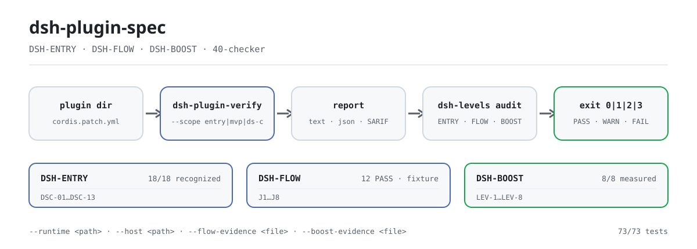

<div align="center">

<picture>
  <source media="(prefers-color-scheme: dark)" srcset="docs/assets/dsh-plugin-spec-flow-dark.svg">
  
</picture>

# dsh-plugin-spec

**Turn the DSH plugin standards into executable checks — clauses and checker in one repository, ready to report on a plugin directory.**

The rule source for the three DSH plugin layers (ENTRY / FLOW / BOOST): clause text, scoring scheme, evidence chain, and governance records, plus a zero-dependency read-only checker.

[Install](#three-step-setup) · [Configuration](#configuration-and-flags) · [FAQ](#faq) · [简体中文](README.md) · [English](README.en.md) · [Español](README.es.md) · [Português](README.pt.md) · [हिन्दी](README.hi.md)

[](LICENSE)
[](https://www.npmjs.com/package/dsh-plugin-spec)
[](https://github.com/PerryLink/dsh-plugin-spec/actions/workflows/cross-platform.yml)
[](#development)

[](https://github.com/PerryLink/dsh-plugin-spec/stargazers)
[](https://www.npmjs.com/package/dsh-plugin-spec)
[](https://gitee.com/perrylink/dsh-plugin-spec)

```sh
# standards text package (published on npm; no bin, no npx command)
npm i -g dsh-plugin-spec

# checker (not published to npm; run it from source)
git clone https://github.com/PerryLink/dsh-plugin-spec.git
node dsh-plugin-spec/40-checker/bin/dsh-plugin-verify.mjs --help
```

</div>

<sub>Unofficial, not a certification, not a security audit; not affiliated with DeepSeek. Canonical repository: <https://github.com/PerryLink/dsh-plugin-spec> (Gitee is a mirror). Copying or modifying this repository's text requires a Change Notice; see [MODIFICATION-POLICY.md](MODIFICATION-POLICY.md).</sub>

## What it is

This repository is the rule source for the three DSH plugin layers: **DSH-ENTRY** (can it be installed and recognized), **DSH-FLOW** (do the J1–J8 journeys go smoothly), and **DSH-BOOST** (do the LEV-1–8 practices have measured gains). The three clause documents (31/32/33), the scoring scheme, the evidence chain, and the governance records all live here.

The same repository ships `40-checker`: a zero-dependency, read-only checker for Node ≥ 20 that turns the clauses into executable `DSC-01`–`DSC-13` verdicts, emitting `text` / `json` / `SARIF` with five outcomes: `PASS` / `WARN` / `FAIL` / `NA` / `ERROR`. Its three-level audit entry point `dsh-levels` merges ENTRY, FLOW, and BOOST into one report.

The standards are drafts: ENTRY has a `recognized` baseline, while FLOW / BOOST are explicitly marked `draft`. The checker is an MVP and only proves what it can prove — `static` is never written as `runtime`, and `not-run` is never written as `PASS`.

| Layer | Standard / practice | Current status |
|---|---|---|
| 1 | **DSH-ENTRY entry standard** | 18/18 `recognized`; base-only 10/18 verified (8 clean + 2 gate-reject); real web profile 18/18 verified (16 clean + 2 gate-reject); client 15/15 loaded; 18/18 clean not achieved |
| 2 | **DSH-FLOW smoothness standard** | draft; J1/J2/J4/J6 **12 PASS** on the fixture; J3/J7 fixture runtime; J5/J8 static preflight; 10 real packages **78 PASS / 4 FAIL / 2 blocked / 66 not-run** |
| 3 | **DSH-BOOST acceleration practices** | draft; LEV-1–8 **8/8 measured** (loader / context / provider-capture / synthetic timer; non-production baseline) |

## Three-step setup

1. **Get the text and the checker**

   ```sh
   npm i -g dsh-plugin-spec        # clause text (no bin)
   git clone https://github.com/PerryLink/dsh-plugin-spec.git
   cd dsh-plugin-spec/40-checker
   node --version                  # requires Node >= 20
   ```

   The checker is not published to npm; the `dsh-plugin-verify` / `dsh-levels` packages on npm are different projects, so **do not** run them through `npx`.

2. **Run static recognition on a plugin directory**

   ```sh
   node bin/dsh-plugin-verify.mjs ./fixtures/good \
     --scope entry --entry-claim static
   ```

   The output contains `scope=entry profile=package status=pass exit=0` and `level: DSH-ENTRY recognized`. `--entry-claim static` claims structural recognition only; to claim runtime, add `--runtime /path/to/cordis/lib/index.js`.

3. **Confirm the three-level conclusion**

   ```sh
   node bin/dsh-levels.mjs audit ./fixtures/good \
     --format json
   ```

   ENTRY runs automatically; FLOW / BOOST read only `--flow-evidence` / `--boost-evidence`. Without evidence they are reported as `not-run` / `not-measured` — the tool never upgrades a claim on the author's behalf.

New to this repository? Start with [START-HERE.md](START-HERE.md); checker details are in [40-checker/README.md](40-checker/README.md).

## Core capabilities

- **One rule source for three layers.** The ENTRY / FLOW / BOOST clauses, the A–D scoring scheme, the evidence formats, and the governance records live together. The execution umbrella is `dsh-standards`; the prose guide is `dsh-plugin-guide`.
- **Zero-dependency checker.** `40-checker` covers `DSC-01`–`DSC-13`; `--scope` has three modes (`ds-c` by default / `mvp` with 8 items / `entry` for the compatibility gate), `--profile` has three (`package` by default / `listing` / `both`), and output is `text` / `json` / `SARIF 2.1.0`.
- **Five outcomes and exit codes.** `PASS` has satisfying evidence; `WARN` is partial; `FAIL` has a counterexample; `NA` is not applicable; `ERROR` means the check could not run. Exit `0` = done with no FAIL, `1` = FAIL present, `2` = incomplete, `3` = usage error.
- **No static/runtime blur.** `--static-only` judges only `DSC-01/02/03/11/12/13` and concludes `DS-C static`; only a real L1–L3 run can yield `DS-C verified`.
- **Three-level audit.** `dsh-levels audit` merges the automatic ENTRY conclusion with FLOW (J1–J8) / BOOST (LEV-1–8) evidence files; without evidence it writes `not-run` / `not-measured`.
- **Evidence chain and governance.** `governance-check`, `attestation-check`, `claim-check`, `dco-check`, and `evidence-chain verify` turn roles, contribution terms, public claims, and evidence into repeatable checks.
- **Read-only.** It never modifies the target directory; the checker itself has no third-party dependencies.

For the companion toolchain choices (scaffold / preflight / host contract / install smoke / market submit), see [docs/DEVELOPER-JOURNEY.md](docs/DEVELOPER-JOURNEY.md).

### Current hard numbers

- 18-package entry static: **18/18 recognized, 0 clean**;
- 18-package DS-C static: **0 PASS / 9 WARN / 9 FAIL**;
- 18-package base-only runtime: **18/18 have raw JSON; 10/18 G3 verified, 8 partial, 0 error**; after the host gate, **8 clean + 2 reject + 8 partial**;
- client runtime: **15/15 `client-module-loaded`** (real Chromium); web-app **4/4 loaded**;
- unusable: **0 plugin code FAIL; 2 host-gate reject (telemetry/verification)**;
- checker: **73/73 tests** (governance / DCO / attestation / claims / verification / chain / drift);
- J1: **6 PASS + 1 WARN**; LEV-3: volatile **0/20** vs control **20/20** remount; LEV-6: stable prefix **100%** vs volatile **0%**; LEV-7: **8.24×** (synthetic, not a production baseline).

## Configuration and flags

The checker reads no configuration file; everything is controlled by command-line flags, with defaults in `40-checker/src/cli.mjs`. Common flags:

| Flag | Default | Purpose |
|---|---|---|
| `--format` | `text` | `text` / `json` / `sarif` |
| `--scope` | `ds-c` | `ds-c` full claim / `mvp` 8 items / `entry` compatibility gate |
| `--profile` | `package` | `package` / `listing`; defaults to `listing` when `--market-index` is given |
| `--runtime` | none | Built `@deepseek-ai/cordis` entry; enables L1–L3 |
| `--entry-claim` | `runtime` | Under `entry` scope, claim `runtime` or `static` |
| `--host` | none | `app-boot/lib/index.js`; bundle G0–G3 |
| `--static-only` | off | M1 static channel: 6 IDs only, conclusion `DS-C static` |
| `--out` | stdout | Write the report to a file |

<details>
<summary>Full flag table (23 items)</summary>

| Flag | Default | Purpose |
|---|---|---|
| `--format` | `text` | Output format: `text` / `json` / `sarif` |
| `--scope` | `ds-c` | `mvp` = 8 MVP checks; `ds-c` = full claim; `entry` = DSH-ENTRY compatibility gate |
| `--profile` | `package` | `package` / `listing` / `both`; defaults to `listing` when `--market-index` is given |
| `--runtime` | none | Built `@deepseek-ai/cordis` `lib/index.js`; enables L1–L3 |
| `--runtime-version` | `0.2.2-alpha.2` | DSH runtime version used by C-2 |
| `--cordis-version` | `4.0.6-alpha.1` | Cordis version recorded in the report anchor |
| `--commit` | `ce7073d51254` | Harness commit recorded in the report anchor |
| `--install-spec` | none | Recommended install spec for C-3 (listing / install check) |
| `--market-index` | none | format-1 market index JSON; enables C-3 listing mode |
| `--plugin-name` | none | Plugin name inside the market index |
| `--timeout` | `10000` | L1–L3 timeout (100–120000 ms) |
| `--no-exec` | off | Skip L1–L3 as `not-run` / `NA`, never `PASS` |
| `--static-only` | off | M1 mode: only `DSC-01/02/03/11/12/13`; C-4–C-9 are out of scope |
| `--treat-as-plugin` | off | Run L1–L3 on a bundle's server entry |
| `--entry-runtime` | `require` | `entry` scope: `require` demands full G0–G3; `server-entry` gives a proxy conclusion |
| `--entry-claim` | `runtime` | `entry` scope: `runtime` needs DSC-14; `static` claims structural recognition only |
| `--host` | none | `app-boot/lib/index.js`; enables bundle G0–G3 smoke |
| `--base` | none | Base `cordis.patch.yml` for bundle smoke |
| `--web` | none | web-app `cordis.patch.yml` for bundle smoke |
| `--bare` | none | Bare-module base (host farm) for bundle smoke |
| `--out` | stdout | Write the report to a file |
| `--help` / `-h` | — | Print usage |
| `--version` / `-v` | — | Print the checker version |

</details>

<details>
<summary><code>dsh-levels audit</code> flags (10 items)</summary>

| Flag | Default | Purpose |
|---|---|---|
| `--host` | none | `app-boot/lib/index.js`; enables real ENTRY G0–G3 |
| `--base` | none | Base `cordis.patch.yml` |
| `--bare` | none | Bare-module farm for bundle smoke |
| `--no-runtime` | off | Force static ENTRY even when `--host` is given |
| `--flow-evidence` | none | FLOW evidence JSON (J1–J8 `pass` / `fail` / `not-run`) |
| `--boost-evidence` | none | BOOST evidence JSON (LEV-1–8 evidence cards) |
| `--timeout` | `150000` | Checker timeout (ms) |
| `--format` | `text` | `text` / `json` |
| `--out` | stdout | Write the JSON result to a file |
| `--help` | — | Print usage |

</details>

## FAQ

<details>
<summary>I installed <code>dsh-plugin-spec</code> from npm — why is there no command?</summary>

The npm package publishes clause text only (its `files` whitelist is README, LICENSE, and the 31/32/33 standards); it has no `bin` field, so `npm i -g` produces no executable and there is no `npx` entry. The checker lives in `40-checker/` and is not published to npm; clone the repository and run `node 40-checker/bin/dsh-plugin-verify.mjs`. The `dsh-plugin-verify` / `dsh-levels` packages on npm are different projects — do not use them to run these clauses.

</details>

<details>
<summary>How do I read <code>PASS</code> / <code>WARN</code> / <code>NA</code> / <code>ERROR</code> / <code>not-run</code>?</summary>

`PASS` = satisfying evidence; `WARN` = partial or insufficient evidence, non-blocking but **not** a PASS; `FAIL` = a concrete counterexample; `NA` = not applicable in this form or context; `ERROR` / `not-run` = the check should have run but did not, or the checker failed. Neither `NA` nor `not-run` is a PASS. A `static` conclusion must not be written as `runtime`: `DS-C verified` requires a real L1–L3 run.

</details>

<details>
<summary>Does it modify my plugin or upload my code?</summary>

No. `40-checker` is a read-only checker: it reads the target directory and writes a report, never modifying the target, and it has no third-party dependencies. L1–L3 needs an explicitly supplied built `@deepseek-ai/cordis` entry (`--runtime`); bundle G0–G3 needs an explicitly supplied `--host`. Without that evidence the report says `not-run` / `incomplete` rather than inventing a conclusion.

</details>

<details>
<summary>Can it run without a host (runtime / host)?</summary>

Yes, but only to a static conclusion. `--scope entry --entry-claim static` performs structural recognition; `--static-only` is the M1 static channel. L1–L3 and bundle G0–G3 require a real host entry; when it is missing, the checker explicitly reports `ERROR` / `not-run` or `incomplete` (exit `2`) instead of pretending to pass.

</details>

<details>
<summary>Can these conclusions serve as certification, ranking, or a security audit?</summary>

No. This repository is a standards draft plus a self-check tool: it does not certify, audit, or rank, and it does not charge money or sell levels. A–D is a quality grade, not a substitute for ENTRY / FLOW / BOOST. The `notClaimed` field also lists official standard, certification, security audit, ranking, and production baseline as unclaimed.

</details>

## Known limitations

**Boundaries (kept verbatim):**

- No fees, no selling levels, no selling rankings;
- No certification / security audit;
- Never write static as runtime;
- Never write 10/18 base-only as 18/18 web/production; never write `client-module-loaded` as UI/certification;
- No claim of official recommendation / adoption;
- No claim of certification / accreditation / security audit; A–D are quality grades, not ENTRY/FLOW/BOOST.

**Checker limitations (quoted from `40-checker/README.md`):**

- `C-3` is judgeable only in `listing` mode; `package` mode reports `NA` with supply-chain advisory evidence only.
- L1–L3 covers 13/14 real packages; `dsh-vision-router` still lacks `lib/session-affinity.js` after building, so it is `FAIL`.
- The `C-8.2` revision/epoch is not observable in Cordis 4.0.5 builds, so the good fixture's C-8 is `WARN`.
- `C-13` judges declaration consistency only; plugins without `dsh.capabilities` cannot be classified.
- `C-10` is advisory and never produces `FAIL`.
- Missing `dsh.commitments` / `dsh.disclosure` is recorded only as `NA` / `WARN`.
- The target must be a directory; tarball / npm package unpacking is not implemented.
- L4 smoke, the GitHub Action, and the M1/M2 dual channel are not implemented; M2 is still not a complete security sandbox (reads remain open; no seccomp/cgroup/read-only root).

## Development

```sh
cd 40-checker
node --test test/*.test.mjs
node bin/dsh-plugin-verify.mjs fixtures/good --format text
node bin/dsh-plugin-verify.mjs fixtures/bad --format text

# J1 install/uninstall journey
node scripts/journey-runtime.mjs --package ./fixtures/good --json

# bundle ENTRY G0–G3 (needs a host)
node bin/dsh-plugin-verify.mjs ./my-bundle --scope entry \
  --host /path/to/app-boot/lib/index.js

# governance / contribution / claims / evidence-chain checks
node scripts/governance-check.mjs
node scripts/attestation-check.mjs
node scripts/claim-check.mjs
node scripts/dco-check.mjs --range HEAD~1..HEAD
node ../publish/verify.mjs --id DSH-ATT-2026-001

# LEV-7 bounded-parallel benchmark
cd ../examples/boost
node lev7-bench.mjs 64 20
```

Layout:

```text
00-99*.md         standards / research / profiles / communication packs
40-checker/       checker, J1 journeys, bundle smoke, sample frame, results
governance/       roles / contribution terms / marks / appeals / COI / log + machine checks
adoption/         official / market / developer adoption packs
spec/             levels.json + clauses.json + schemas
examples/boost/   LEV-7 reference implementation and benchmark
publish/          label examples + attestation JSON
scripts/          gen-readme-assets.py (asset regeneration)
docs/assets/      README assets (light/dark SVG pair)
```

Assets are generated programmatically by `scripts/gen-readme-assets.py` (Python + Pillow) and can be regenerated with `python scripts/gen-readme-assets.py`. It requires Pillow and a CJK font (the script probes for one and aborts if none is found).

### Governance and contribution

- Roles and permissions: `governance/roles.json`; one-page guide: [GOVERNANCE.md](GOVERNANCE.md)
- Contribution: DCO 1.1 + DCT v1 (`dsh-ct/1`); see [CONTRIBUTING.md](CONTRIBUTING.md)
- Marks: `governance/mark-policy.md` (auto-granted, revocable, disclaimer required)
- Appeals: `governance/appeals.md`; AI only accepts / times / reviews, humans make the final ruling
- Three-purpose adoption packs: `adoption/{official,market,developer}/`

## Family and acknowledgements

This project is maintained by [PerryLink](https://github.com/PerryLink) and is the **rule source** of the DeepSeek Harness plugin family: the execution umbrella is [dsh-standards](https://github.com/PerryLink/dsh-standards), the prose guide is [dsh-plugin-guide](https://github.com/PerryLink/dsh-plugin-guide), and the toolchain is [dsh-plugin-devtools](https://github.com/PerryLink/dsh-plugin-devtools).

If these clauses or the checker helped you, **give it a star** — it unlocks nothing, but it helps the next person find it.

The earlier project `dsh-plugin-standard` (lanbaolu) is a separate effort with no affiliation; citations or comparisons will note their source.

- [@PerryLink](https://github.com/PerryLink) — creator and maintainer: the three-layer clauses, the DSC checker, the evidence chain and governance records, and the five-language docs.

## License

- Text / standards / documentation / translations: **CC BY 4.0** ([LICENSE-CC-BY](LICENSE-CC-BY)); copying or modifying requires a Change Notice per [MODIFICATION-POLICY.md](MODIFICATION-POLICY.md) (source commit, section changed, what changed, why, date);
- Code / scripts / schemas: **Apache-2.0** ([LICENSE-APACHE](LICENSE-APACHE), including patent grant and defensive termination);
- Marks / badges: separate rules in [governance/mark-policy.md](governance/mark-policy.md), not granted by the licenses above;
- Contributions: DCO 1.1 + DCT v1, no copyright assignment required.

Attribution and provenance notes are in [NOTICE](NOTICE) and [CONTRIBUTING.md](CONTRIBUTING.md). `DeepSeek Harness` is a trademark of DeepSeek; this project uses only the `DSH` abbreviation.

<p align="center"><sub>CC BY 4.0 (text) / Apache-2.0 (code) · unofficial standards draft, not affiliated with DeepSeek.</sub></p>
