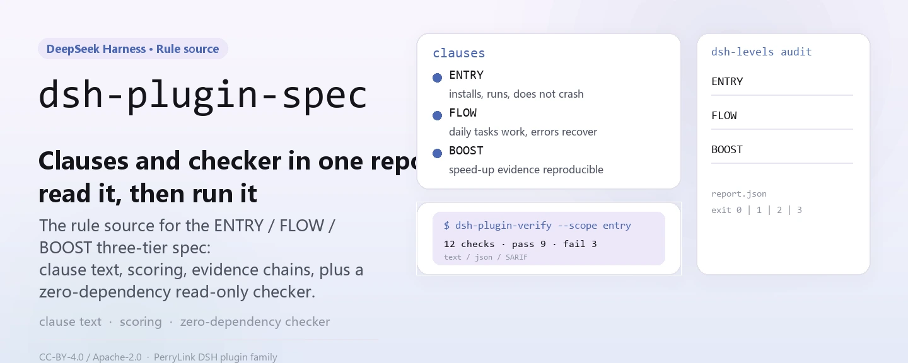
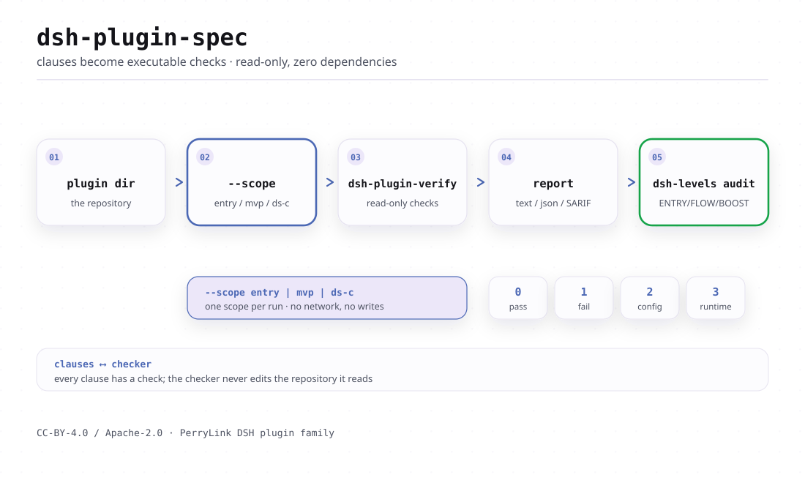

<div align="center">

<picture>
  <source media="(prefers-color-scheme: dark)" srcset="docs/assets/dsh-plugin-spec-hero-en-dark.webp">
  
</picture>

# dsh-plugin-spec

**Convierte los estándares de plugins de DSH en comprobaciones ejecutables: cláusulas y verificador en un mismo repositorio, listo para emitir un informe sobre un directorio de plugin.**

La fuente de reglas de las tres capas de plugins de DSH (ENTRY / FLOW / BOOST): texto de cláusulas, esquema de puntuación, cadena de evidencia y registros de gobernanza, más un verificador de solo lectura sin dependencias.

[Instalar](#instalación-en-tres-pasos) · [Configuración](#configuración-y-parámetros) · [FAQ](#faq) · [简体中文](README.md) · [English](README.en.md) · [Español](README.es.md) · [Português](README.pt.md) · [हिन्दी](README.hi.md)

[](LICENSE)
[](https://www.npmjs.com/package/dsh-plugin-spec)
[](https://github.com/PerryLink/dsh-plugin-spec/actions/workflows/cross-platform.yml)
[](#desarrollo)

[](https://github.com/PerryLink/dsh-plugin-spec/stargazers)
[](https://www.npmjs.com/package/dsh-plugin-spec)
[](https://gitee.com/perrylink/dsh-plugin-spec)

```sh
# paquete de texto de las normas (publicado en npm; sin bin, sin comando npx)
npm i -g dsh-plugin-spec

# verificador (no publicado en npm; se ejecuta desde el código fuente)
git clone https://github.com/PerryLink/dsh-plugin-spec.git
node dsh-plugin-spec/40-checker/bin/dsh-plugin-verify.mjs --help
```

</div>

<sub>No oficial, no es una certificación ni una auditoría de seguridad; sin relación con DeepSeek. Repositorio canónico: <https://github.com/PerryLink/dsh-plugin-spec> (Gitee es un espejo). Copiar o modificar el texto de este repositorio exige un Change Notice; véase [MODIFICATION-POLICY.md](MODIFICATION-POLICY.md).</sub>

## Qué es

Este repositorio es la fuente de reglas de las tres capas de plugins de DSH: **DSH-ENTRY** (¿se puede instalar y reconocer?), **DSH-FLOW** (¿los recorridos J1–J8 fluyen sin fricción?) y **DSH-BOOST** (¿las prácticas LEV-1–8 tienen ganancias medidas?). Los tres documentos de cláusulas (31/32/33), el esquema de puntuación, la cadena de evidencia y los registros de gobernanza viven aquí.

En el mismo repositorio está `40-checker`: un verificador de solo lectura, sin dependencias, para Node ≥ 20, que convierte las cláusulas en veredictos ejecutables `DSC-01`–`DSC-13` y emite `text` / `json` / `SARIF` con cinco resultados: `PASS` / `WARN` / `FAIL` / `NA` / `ERROR`. Su entrada de auditoría de tres niveles, `dsh-levels`, fusiona ENTRY, FLOW y BOOST en un solo informe.

Las normas son borradores: ENTRY ya tiene una base `recognized`, mientras que FLOW / BOOST se marcan explícitamente como `draft`. El verificador es un MVP y solo demuestra lo que puede demostrar: `static` nunca se escribe como `runtime` y `not-run` nunca se escribe como `PASS`.

| Capa | Norma / práctica | Estado actual |
|---|---|---|
| 1 | **Norma de entrada DSH-ENTRY** | 18/18 `recognized`; base-only 10/18 verificados (8 clean + 2 gate-reject); perfil web real 18/18 verificados (16 clean + 2 gate-reject); client 15/15 cargados; 18/18 clean no alcanzado |
| 2 | **Norma de fluidez DSH-FLOW** | draft; J1/J2/J4/J6 **12 PASS** en el fixture; J3/J7 runtime de fixture; J5/J8 preflight estático; 10 paquetes reales **78 PASS / 4 FAIL / 2 blocked / 66 not-run** |
| 3 | **Prácticas de aceleración DSH-BOOST** | draft; LEV-1–8 **8/8 medidos** (loader / context / provider-capture / temporizador sintético; línea base no productiva) |

<picture>
  <source media="(prefers-color-scheme: dark)" srcset="docs/assets/dsh-plugin-spec-flow-v3-dark.svg">
  
</picture>

## Instalación en tres pasos

1. **Obtener el texto y el verificador**

   ```sh
   npm i -g dsh-plugin-spec        # texto de cláusulas (sin bin)
   git clone https://github.com/PerryLink/dsh-plugin-spec.git
   cd dsh-plugin-spec/40-checker
   node --version                  # requiere Node >= 20
   ```

   El verificador no está publicado en npm; los paquetes `dsh-plugin-verify` / `dsh-levels` de npm son otros proyectos, así que **no** los ejecutes con `npx`.

2. **Ejecutar el reconocimiento estático sobre un directorio de plugin**

   ```sh
   node bin/dsh-plugin-verify.mjs ./fixtures/good \
     --scope entry --entry-claim static
   ```

   La salida contiene `scope=entry profile=package status=pass exit=0` y `level: DSH-ENTRY recognized`. `--entry-claim static` declara solo reconocimiento estructural; para declarar runtime hay que añadir `--runtime /path/to/cordis/lib/index.js`.

3. **Confirmar la conclusión de tres niveles**

   ```sh
   node bin/dsh-levels.mjs audit ./fixtures/good \
     --format json
   ```

   ENTRY se ejecuta automáticamente; FLOW / BOOST solo leen `--flow-evidence` / `--boost-evidence`. Sin evidencia se escriben `not-run` / `not-measured`: la herramienta nunca eleva una afirmación por su cuenta.

¿Es tu primera vez en este repositorio? Empieza por [START-HERE.md](START-HERE.md); los detalles del verificador están en [40-checker/README.md](40-checker/README.md).

## Capacidades principales

- **Una fuente de reglas para tres capas.** Las cláusulas ENTRY / FLOW / BOOST, el esquema de puntuación A–D, los formatos de evidencia y los registros de gobernanza se mantienen juntos. El proyecto paraguas de ejecución es `dsh-standards`; la guía en prosa es `dsh-plugin-guide`.
- **Verificador sin dependencias.** `40-checker` cubre `DSC-01`–`DSC-13`; `--scope` tiene tres modos (`ds-c` por defecto / `mvp` con 8 elementos / `entry` para la puerta de compatibilidad), `--profile` tiene tres (`package` por defecto / `listing` / `both`), y la salida es `text` / `json` / `SARIF 2.1.0`.
- **Cinco resultados y códigos de salida.** `PASS` tiene evidencia suficiente; `WARN` es parcial; `FAIL` tiene un contraejemplo; `NA` no aplica; `ERROR` indica que la comprobación no pudo ejecutarse. Exit `0` = terminado sin FAIL, `1` = hay FAIL, `2` = incompleto, `3` = error de uso.
- **Sin mezclar estático y runtime.** `--static-only` solo evalúa `DSC-01/02/03/11/12/13` y concluye `DS-C static`; solo una ejecución real L1–L3 puede dar `DS-C verified`.
- **Auditoría de tres niveles.** `dsh-levels audit` fusiona la conclusión automática de ENTRY con los archivos de evidencia de FLOW (J1–J8) / BOOST (LEV-1–8); sin evidencia escribe `not-run` / `not-measured`.
- **Cadena de evidencia y gobernanza.** `governance-check`, `attestation-check`, `claim-check`, `dco-check` y `evidence-chain verify` convierten roles, términos de contribución, afirmaciones públicas y evidencia en comprobaciones repetibles.
- **Solo lectura.** Nunca modifica el directorio objetivo; el verificador no tiene dependencias de terceros.

Para elegir la cadena de herramientas complementaria (scaffold / preflight / contrato de host / smoke de instalación / envío al mercado), véase [docs/DEVELOPER-JOURNEY.md](docs/DEVELOPER-JOURNEY.md).

### Cifras actuales

- entry static de 18 paquetes: **18/18 recognized, 0 clean**;
- DS-C static de 18 paquetes: **0 PASS / 9 WARN / 9 FAIL**;
- runtime base-only de 18 paquetes: **18/18 con JSON crudo; 10/18 G3 verificados, 8 parciales, 0 errores**; tras la puerta de host, **8 clean + 2 reject + 8 parciales**;
- runtime de client: **15/15 `client-module-loaded`** (Chromium real); web-app **4/4 cargados**;
- no utilizables: **0 FAIL de código de plugin; 2 rechazos de puerta de host (telemetry/verification)**;
- verificador: **73/73 pruebas** (gobernanza / DCO / atestación / afirmaciones / verificación / cadena / deriva);
- J1: **6 PASS + 1 WARN**; LEV-3: volatile **0/20** frente a control **20/20** remount; LEV-6: prefijo estable **100%** frente a volátil **0%**; LEV-7: **8.24×** (sintético, no una línea base de producción).

## Configuración y parámetros

El verificador no lee ningún archivo de configuración; todo se controla con parámetros de línea de comandos, con valores por defecto en `40-checker/src/cli.mjs`. Parámetros habituales:

| Parámetro | Por defecto | Función |
|---|---|---|
| `--format` | `text` | `text` / `json` / `sarif` |
| `--scope` | `ds-c` | `ds-c` declaración completa / `mvp` 8 elementos / `entry` puerta de compatibilidad |
| `--profile` | `package` | `package` / `listing`; pasa a `listing` si se da `--market-index` |
| `--runtime` | ninguno | Entrada compilada de `@deepseek-ai/cordis`; activa L1–L3 |
| `--entry-claim` | `runtime` | En `entry`, declara `runtime` o `static` |
| `--host` | ninguno | `app-boot/lib/index.js`; G0–G3 de bundle |
| `--static-only` | no | Canal estático M1: solo 6 ID, conclusión `DS-C static` |
| `--out` | stdout | Escribe el informe en un archivo |

<details>
<summary>Tabla completa de parámetros (23 elementos)</summary>

| Parámetro | Por defecto | Función |
|---|---|---|
| `--format` | `text` | Formato de salida: `text` / `json` / `sarif` |
| `--scope` | `ds-c` | `mvp` = 8 comprobaciones MVP; `ds-c` = declaración completa; `entry` = puerta de compatibilidad DSH-ENTRY |
| `--profile` | `package` | `package` / `listing` / `both`; pasa a `listing` si se da `--market-index` |
| `--runtime` | ninguno | `lib/index.js` compilado de `@deepseek-ai/cordis`; activa L1–L3 |
| `--runtime-version` | `0.2.2-alpha.2` | Versión de runtime DSH usada por C-2 |
| `--cordis-version` | `4.0.6-alpha.1` | Versión de Cordis registrada en el ancla del informe |
| `--commit` | `ce7073d51254` | Commit del harness registrado en el ancla del informe |
| `--install-spec` | ninguno | Especificación de instalación recomendada para C-3 (listing / install) |
| `--market-index` | ninguno | JSON de índice de mercado format-1; activa el modo C-3 listing |
| `--plugin-name` | ninguno | Nombre del plugin dentro del índice de mercado |
| `--timeout` | `10000` | Tiempo de espera de L1–L3 (100–120000 ms) |
| `--no-exec` | no | Omite L1–L3 como `not-run` / `NA`, nunca `PASS` |
| `--static-only` | no | Modo M1: solo `DSC-01/02/03/11/12/13`; C-4–C-9 quedan fuera de alcance |
| `--treat-as-plugin` | no | Ejecuta L1–L3 sobre el server entry de un bundle |
| `--entry-runtime` | `require` | En `entry`: `require` exige G0–G3 completos; `server-entry` da una conclusión proxy |
| `--entry-claim` | `runtime` | En `entry`: `runtime` exige DSC-14; `static` solo declara reconocimiento estructural |
| `--host` | ninguno | `app-boot/lib/index.js`; activa el smoke G0–G3 de bundle |
| `--base` | ninguno | `cordis.patch.yml` base para el smoke de bundle |
| `--web` | ninguno | `cordis.patch.yml` de web-app para el smoke de bundle |
| `--bare` | ninguno | Base de módulos desnudos (host farm) para el smoke de bundle |
| `--out` | stdout | Escribe el informe en un archivo |
| `--help` / `-h` | — | Muestra el uso |
| `--version` / `-v` | — | Muestra la versión del verificador |

</details>

<details>
<summary>Parámetros de <code>dsh-levels audit</code> (10 elementos)</summary>

| Parámetro | Por defecto | Función |
|---|---|---|
| `--host` | ninguno | `app-boot/lib/index.js`; activa ENTRY G0–G3 real |
| `--base` | ninguno | `cordis.patch.yml` base |
| `--bare` | ninguno | Host farm de módulos desnudos para el smoke de bundle |
| `--no-runtime` | no | Fuerza ENTRY estático aunque se dé `--host` |
| `--flow-evidence` | ninguno | JSON de evidencia FLOW (J1–J8 `pass` / `fail` / `not-run`) |
| `--boost-evidence` | ninguno | JSON de evidencia BOOST (tarjetas de LEV-1–8) |
| `--timeout` | `150000` | Tiempo de espera del verificador (ms) |
| `--format` | `text` | `text` / `json` |
| `--out` | stdout | Escribe el resultado JSON en un archivo |
| `--help` | — | Muestra el uso |

</details>

## FAQ

<details>
<summary>Instalé <code>dsh-plugin-spec</code> desde npm, ¿por qué no hay ningún comando?</summary>

El paquete npm solo publica texto de cláusulas (su lista `files` es README, LICENSE y las normas 31/32/33); no tiene campo `bin`, así que `npm i -g` no produce ningún ejecutable y tampoco hay entrada `npx`. El verificador vive en `40-checker/` y no está publicado en npm; clona el repositorio y ejecuta `node 40-checker/bin/dsh-plugin-verify.mjs`. Los paquetes `dsh-plugin-verify` / `dsh-levels` de npm son otros proyectos: no los uses para ejecutar estas cláusulas.

</details>

<details>
<summary>¿Cómo se leen <code>PASS</code> / <code>WARN</code> / <code>NA</code> / <code>ERROR</code> / <code>not-run</code>?</summary>

`PASS` = hay evidencia que satisface; `WARN` = parcial o evidencia insuficiente, no bloquea pero **no** es PASS; `FAIL` = contraejemplo concreto; `NA` = no aplica en esta forma o contexto; `ERROR` / `not-run` = debía ejecutarse y no se ejecutó, o el verificador falló. Ni `NA` ni `not-run` son PASS. Una conclusión `static` no debe escribirse como `runtime`: `DS-C verified` exige una ejecución real L1–L3.

</details>

<details>
<summary>¿Modifica mi plugin o sube mi código?</summary>

No. `40-checker` es un verificador de solo lectura: lee el directorio objetivo y escribe un informe, sin modificar el objetivo, y no tiene dependencias de terceros. L1–L3 necesita una entrada compilada de `@deepseek-ai/cordis` proporcionada explícitamente (`--runtime`); el G0–G3 de bundle necesita un `--host` explícito. Sin esa evidencia el informe dice `not-run` / `incomplete` en lugar de inventar una conclusión.

</details>

<details>
<summary>¿Puede ejecutarse sin host (runtime / host)?</summary>

Sí, pero solo hasta una conclusión estática. `--scope entry --entry-claim static` hace reconocimiento estructural; `--static-only` es el canal estático M1. L1–L3 y el G0–G3 de bundle requieren una entrada de host real; cuando falta, el verificador informa explícitamente `ERROR` / `not-run` o `incomplete` (exit `2`) en lugar de fingir que pasa.

</details>

<details>
<summary>¿Sirven estas conclusiones como certificación, ranking o auditoría de seguridad?</summary>

No. Este repositorio es un borrador de normas y una herramienta de autocomprobación: no certifica, no audita y no clasifica; no cobra ni vende niveles. A–D es una calificación de calidad, no un sustituto de ENTRY / FLOW / BOOST. El campo `notClaimed` también enumera como no declarados la norma oficial, la certificación, la auditoría de seguridad, el ranking y la línea base de producción.

</details>

## Limitaciones conocidas

**Límites (conservados literalmente):**

- Sin cobros, sin venta de niveles, sin venta de rankings;
- Sin certificación / auditoría de seguridad;
- Nunca escribir static como runtime;
- Nunca escribir 10/18 base-only como 18/18 web/producción; nunca escribir `client-module-loaded` como UI/certificación;
- Sin afirmación de recomendación / adopción oficial;
- Sin afirmación de certificación / acreditación / auditoría de seguridad; A–D son calificaciones de calidad, no ENTRY/FLOW/BOOST.

**Limitaciones del verificador (citadas de `40-checker/README.md`):**

- `C-3` solo se puede juzgar en modo `listing`; el modo `package` informa `NA` con evidencia advisory de cadena de suministro únicamente.
- L1–L3 cubre 13/14 paquetes reales; `dsh-vision-router` sigue sin `lib/session-affinity.js` tras compilar, por lo que es `FAIL`.
- La revisión/epoch de `C-8.2` no es observable en compilaciones de Cordis 4.0.5, así que el C-8 del fixture good es `WARN`.
- `C-13` solo juzga la consistencia de la declaración; los plugins sin `dsh.capabilities` no se pueden clasificar.
- `C-10` es advisory y nunca produce `FAIL`.
- La ausencia de `dsh.commitments` / `dsh.disclosure` solo se registra como `NA` / `WARN`.
- El objetivo debe ser un directorio; el desempaquetado de tarball / paquete npm no está implementado.
- El smoke L4, la GitHub Action y el doble canal M1/M2 no están implementados; M2 sigue sin ser una caja de arena de seguridad completa (las lecturas siguen abiertas; sin seccomp/cgroup/root de solo lectura).

## Desarrollo

```sh
cd 40-checker
node --test test/*.test.mjs
node bin/dsh-plugin-verify.mjs fixtures/good --format text
node bin/dsh-plugin-verify.mjs fixtures/bad --format text

# recorrido J1 de instalación/desinstalación
node scripts/journey-runtime.mjs --package ./fixtures/good --json

# ENTRY G0–G3 de bundle (necesita un host)
node bin/dsh-plugin-verify.mjs ./my-bundle --scope entry \
  --host /path/to/app-boot/lib/index.js

# comprobaciones de gobernanza / contribución / afirmaciones / cadena de evidencia
node scripts/governance-check.mjs
node scripts/attestation-check.mjs
node scripts/claim-check.mjs
node scripts/dco-check.mjs --range HEAD~1..HEAD
node ../publish/verify.mjs --id DSH-ATT-2026-001

# benchmark de paralelismo acotado LEV-7
cd ../examples/boost
node lev7-bench.mjs 64 20
```

Estructura:

```text
00-99*.md         normas / investigación / perfiles / paquetes de comunicación
40-checker/       verificador, recorridos J1, smoke de bundle, marco de muestras, resultados
governance/       roles / términos de contribución / marcas / apelaciones / COI / registro + comprobaciones
adoption/         paquetes de adopción official / market / developer
spec/             levels.json + clauses.json + schemas
examples/boost/   implementación de referencia y benchmark LEV-7
publish/          ejemplos de labels + JSON de atestación
scripts/          gen-readme-assets.py (regeneración de recursos)
docs/assets/      recursos del README (par SVG claro/oscuro)
```

Los recursos se generan programáticamente con `scripts/gen-readme-assets.py` (Python + Pillow) y se pueden regenerar con `python scripts/gen-readme-assets.py`. Requiere Pillow y una fuente CJK (el script la busca y aborta si no encuentra ninguna).

### Gobernanza y contribución

- Roles y permisos: `governance/roles.json`; guía de una página: [GOVERNANCE.md](GOVERNANCE.md)
- Contribución: DCO 1.1 + DCT v1 (`dsh-ct/1`); véase [CONTRIBUTING.md](CONTRIBUTING.md)
- Marcas: `governance/mark-policy.md` (concesión automática, revocable, con descargo de responsabilidad obligatorio)
- Apelaciones: `governance/appeals.md`; la IA solo recibe / cronometra / revisa, la decisión final es humana
- Paquetes de adopción de tres propósitos: `adoption/{official,market,developer}/`

## Familia y agradecimientos

Este proyecto lo mantiene [PerryLink](https://github.com/PerryLink) y es la **fuente de reglas** de la familia de plugins de DeepSeek Harness: el proyecto paraguas de ejecución es [dsh-standards](https://github.com/PerryLink/dsh-standards), la guía en prosa es [dsh-plugin-guide](https://github.com/PerryLink/dsh-plugin-guide) y la cadena de herramientas es [dsh-plugin-devtools](https://github.com/PerryLink/dsh-plugin-devtools).

Si estas cláusulas o el verificador te ayudaron, **dale una estrella**: no desbloquea nada, pero ayuda a que la siguiente persona lo encuentre.

El proyecto anterior `dsh-plugin-standard` (lanbaolu) es un esfuerzo independiente sin afiliación; las citas o comparaciones indicarán su origen.

- [@PerryLink](https://github.com/PerryLink): creador y mantenedor de las cláusulas de tres capas, el verificador DSC, la cadena de evidencia y los registros de gobernanza, y la documentación en cinco idiomas.

## Licencia

- Texto / normas / documentación / traducciones: **CC BY 4.0** ([LICENSE-CC-BY](LICENSE-CC-BY)); copiar o modificar exige un Change Notice según [MODIFICATION-POLICY.md](MODIFICATION-POLICY.md) (commit de origen, sección modificada, qué cambió, por qué, fecha);
- Código / scripts / esquemas: **Apache-2.0** ([LICENSE-APACHE](LICENSE-APACHE), con concesión de patentes y terminación defensiva);
- Marcas / badges: reglas aparte en [governance/mark-policy.md](governance/mark-policy.md), no concedidas por las licencias anteriores;
- Contribuciones: DCO 1.1 + DCT v1, sin cesión de derechos de autor.

Las notas de atribución y procedencia están en [NOTICE](NOTICE) y [CONTRIBUTING.md](CONTRIBUTING.md). `DeepSeek Harness` es una marca de DeepSeek; este proyecto usa solo la abreviatura `DSH`.

<p align="center"><sub>CC BY 4.0 (texto) / Apache-2.0 (código) · borrador de normas no oficial, sin relación con DeepSeek.</sub></p>
