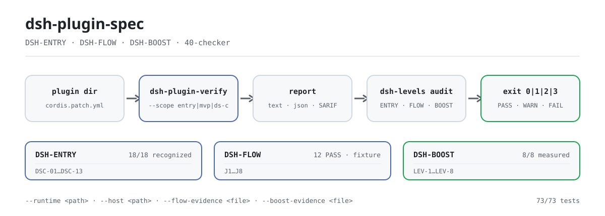

<div align="center">

<picture>
  <source media="(prefers-color-scheme: dark)" srcset="docs/assets/dsh-plugin-spec-flow-dark.svg">
  
</picture>

# dsh-plugin-spec

**DSH प्लगइन मानकों को चलाने योग्य जाँच में बदलें — क्लॉज़ और चेकर एक ही रेपो में, प्लगइन डायरेक्टरी पर रिपोर्ट तैयार。**

DSH प्लगइन की तीन परतों (ENTRY / FLOW / BOOST) का नियम-स्रोत: क्लॉज़ पाठ, स्कोरिंग योजना, साक्ष्य-श्रृंखला और शासन-रिकॉर्ड, साथ में बिना किसी निर्भरता वाला केवल-पढ़ने वाला चेकर।

[इंस्टॉल](#तीन-चरणों-में-शुरुआत) · [कॉन्फ़िगरेशन](#कॉन्फ़िगरेशन-और-पैरामीटर) · [FAQ](#faq) · [简体中文](README.md) · [English](README.en.md) · [Español](README.es.md) · [Português](README.pt.md) · [हिन्दी](README.hi.md)

[](LICENSE)
[](https://www.npmjs.com/package/dsh-plugin-spec)
[](https://github.com/PerryLink/dsh-plugin-spec/actions/workflows/cross-platform.yml)
[](#विकास)

[](https://github.com/PerryLink/dsh-plugin-spec/stargazers)
[](https://www.npmjs.com/package/dsh-plugin-spec)
[](https://gitee.com/perrylink/dsh-plugin-spec)

```sh
# मानक पाठ पैकेज (npm पर प्रकाशित; कोई bin नहीं, कोई npx कमांड नहीं)
npm i -g dsh-plugin-spec

# चेकर (npm पर प्रकाशित नहीं; स्रोत से चलाएँ)
git clone https://github.com/PerryLink/dsh-plugin-spec.git
node dsh-plugin-spec/40-checker/bin/dsh-plugin-verify.mjs --help
```

</div>

<sub>अनौपचारिक, प्रमाणन या सुरक्षा ऑडिट नहीं; DeepSeek से कोई संबद्धता नहीं। एकमात्र रेपो: <https://github.com/PerryLink/dsh-plugin-spec> (Gitee मिरर है)। इस रेपो का पाठ कॉपी या बदलने पर Change Notice आवश्यक है; देखें [MODIFICATION-POLICY.md](MODIFICATION-POLICY.md)।</sub>

## यह क्या है

यह रेपो DSH प्लगइन की तीन परतों का नियम-स्रोत है: **DSH-ENTRY** (इंस्टॉल और पहचान हो सकती है या नहीं), **DSH-FLOW** (J1–J8 यात्राएँ बिना अटकाव के चलती हैं या नहीं) और **DSH-BOOST** (LEV-1–8 प्रथाओं का मापा गया लाभ है या नहीं)। तीन क्लॉज़ दस्तावेज़ (31/32/33), स्कोरिंग योजना, साक्ष्य-श्रृंखला और शासन-रिकॉर्ड यहाँ साथ रहते हैं।

इसी रेपो में `40-checker` है: Node ≥ 20 के लिए बिना निर्भरता वाला, केवल-पढ़ने वाला चेकर, जो क्लॉज़ को चलाने योग्य `DSC-01`–`DSC-13` निर्णयों में बदलता है और `PASS` / `WARN` / `FAIL` / `NA` / `ERROR` पाँच परिणामों के साथ `text` / `json` / `SARIF` आउटपुट देता है। इसका तीन-स्तरीय ऑडिट प्रवेश `dsh-levels` ENTRY, FLOW और BOOST को एक रिपोर्ट में जोड़ता है।

मानक ड्राफ़्ट हैं: ENTRY का `recognized` आधार बन चुका है, जबकि FLOW / BOOST स्पष्ट रूप से `draft` चिह्नित हैं। चेकर एक MVP है और केवल वही साबित करता है जो वह साबित कर सकता है — `static` को कभी `runtime` नहीं लिखा जाता, और `not-run` को कभी `PASS` नहीं लिखा जाता।

| परत | मानक / प्रथा | वर्तमान स्थिति |
|---|---|---|
| 1 | **DSH-ENTRY प्रवेश मानक** | 18/18 `recognized`; base-only 10/18 सत्यापित (8 clean + 2 gate-reject); वास्तविक web profile 18/18 सत्यापित (16 clean + 2 gate-reject); client 15/15 लोड; 18/18 clean नहीं हुआ |
| 2 | **DSH-FLOW सहजता मानक** | draft; fixture पर J1/J2/J4/J6 **12 PASS**; J3/J7 fixture runtime; J5/J8 static preflight; 10 वास्तविक पैकेज **78 PASS / 4 FAIL / 2 blocked / 66 not-run** |
| 3 | **DSH-BOOST त्वरण प्रथाएँ** | draft; LEV-1–8 **8/8 मापे गए** (loader / context / provider-capture / synthetic timer; गैर-उत्पादन आधार) |

## तीन चरणों में शुरुआत

1. **पाठ और चेकर प्राप्त करें**

   ```sh
   npm i -g dsh-plugin-spec        # क्लॉज़ पाठ (कोई bin नहीं)
   git clone https://github.com/PerryLink/dsh-plugin-spec.git
   cd dsh-plugin-spec/40-checker
   node --version                  # Node >= 20 आवश्यक
   ```

   चेकर npm पर प्रकाशित नहीं है; npm के `dsh-plugin-verify` / `dsh-levels` अन्य प्रोजेक्ट हैं, इसलिए उन्हें `npx` से **न** चलाएँ।

2. **प्लगइन डायरेक्टरी पर स्थिर पहचान चलाएँ**

   ```sh
   node bin/dsh-plugin-verify.mjs ./fixtures/good \
     --scope entry --entry-claim static
   ```

   आउटपुट में `scope=entry profile=package status=pass exit=0` और `level: DSH-ENTRY recognized` होता है। `--entry-claim static` केवल संरचनात्मक पहचान का दावा करता है; runtime का दावा करने के लिए `--runtime /path/to/cordis/lib/index.js` जोड़ें।

3. **तीन-स्तरीय निष्कर्ष की पुष्टि करें**

   ```sh
   node bin/dsh-levels.mjs audit ./fixtures/good \
     --format json
   ```

   ENTRY स्वतः चलता है; FLOW / BOOST केवल `--flow-evidence` / `--boost-evidence` पढ़ते हैं। साक्ष्य न होने पर `not-run` / `not-measured` लिखा जाता है — टूल कभी लेखक की ओर से दावा नहीं बढ़ाता।

इस रेपो में नए हैं? [START-HERE.md](START-HERE.md) से शुरू करें; चेकर का विवरण [40-checker/README.md](40-checker/README.md) में है।

## मुख्य क्षमताएँ

- **तीन परतों के लिए एक नियम-स्रोत।** ENTRY / FLOW / BOOST के क्लॉज़, A–D स्कोरिंग योजना, साक्ष्य प्रारूप और शासन-रिकॉर्ड साथ रखे जाते हैं। निष्पादन का छत्र `dsh-standards` है; गद्य मार्गदर्शिका `dsh-plugin-guide` है।
- **बिना निर्भरता वाला चेकर।** `40-checker` `DSC-01`–`DSC-13` कवर करता है; `--scope` के तीन मोड हैं (`ds-c` डिफ़ॉल्ट / `mvp` 8 आइटम / `entry` संगतता द्वार), `--profile` के तीन (`package` डिफ़ॉल्ट / `listing` / `both`), और आउटपुट `text` / `json` / `SARIF 2.1.0` है।
- **पाँच परिणाम और exit कोड।** `PASS` के पास संतोषजनक साक्ष्य है; `WARN` आंशिक है; `FAIL` के पास प्रतिउदाहरण है; `NA` लागू नहीं; `ERROR` का अर्थ है जाँच नहीं चल सकी। exit `0` = FAIL के बिना पूर्ण, `1` = FAIL मौजूद, `2` = अपूर्ण, `3` = उपयोग त्रुटि।
- **static और runtime में कोई मिलावट नहीं।** `--static-only` केवल `DSC-01/02/03/11/12/13` जाँचता है और `DS-C static` निष्कर्ष देता है; केवल वास्तविक L1–L3 रन ही `DS-C verified` दे सकता है।
- **तीन-स्तरीय ऑडिट।** `dsh-levels audit` स्वचालित ENTRY निष्कर्ष को FLOW (J1–J8) / BOOST (LEV-1–8) साक्ष्य फ़ाइलों के साथ जोड़ता है; साक्ष्य न होने पर `not-run` / `not-measured` लिखता है।
- **साक्ष्य-श्रृंखला और शासन।** `governance-check`, `attestation-check`, `claim-check`, `dco-check` और `evidence-chain verify` भूमिकाओं, योगदान शर्तों, सार्वजनिक दावों और साक्ष्य को दोहराने योग्य जाँचों में बदलते हैं।
- **केवल-पढ़ना।** लक्ष्य डायरेक्टरी को कभी नहीं बदलता; चेकर में कोई तृतीय-पक्ष निर्भरता नहीं है।

साथी टूलचेन के चयन (scaffold / preflight / host अनुबंध / इंस्टॉल स्मोक / मार्केट सबमिट) के लिए [docs/DEVELOPER-JOURNEY.md](docs/DEVELOPER-JOURNEY.md) देखें।

### मौजूदा ठोस आँकड़े

- 18 पैकेज entry static: **18/18 recognized, 0 clean**;
- 18 पैकेज DS-C static: **0 PASS / 9 WARN / 9 FAIL**;
- 18 पैकेज base-only runtime: **18/18 के पास कच्चा JSON; 10/18 G3 सत्यापित, 8 आंशिक, 0 त्रुटि**; host gate के बाद **8 clean + 2 reject + 8 आंशिक**;
- client runtime: **15/15 `client-module-loaded`** (वास्तविक Chromium); web-app **4/4 लोड**;
- अनुपयोगी: **0 plugin code FAIL; 2 host-gate reject (telemetry/verification)**;
- चेकर: **73/73 परीक्षण** (शासन / DCO / प्रमाणन / दावे / सत्यापन / श्रृंखला / ड्रिफ़्ट);
- J1: **6 PASS + 1 WARN**; LEV-3: volatile **0/20** बनाम control **20/20** remount; LEV-6: स्थिर prefix **100%** बनाम अस्थिर **0%**; LEV-7: **8.24×** (कृत्रिम, उत्पादन आधार नहीं)।

## कॉन्फ़िगरेशन और पैरामीटर

चेकर कोई कॉन्फ़िगरेशन फ़ाइल नहीं पढ़ता; सब कुछ कमांड-लाइन पैरामीटर से नियंत्रित होता है, डिफ़ॉल्ट `40-checker/src/cli.mjs` में हैं। सामान्य पैरामीटर:

| पैरामीटर | डिफ़ॉल्ट | कार्य |
|---|---|---|
| `--format` | `text` | `text` / `json` / `sarif` |
| `--scope` | `ds-c` | `ds-c` पूर्ण दावा / `mvp` 8 आइटम / `entry` संगतता द्वार |
| `--profile` | `package` | `package` / `listing`; `--market-index` देने पर `listing` |
| `--runtime` | कोई नहीं | बना हुआ `@deepseek-ai/cordis` प्रवेश; L1–L3 सक्षम करता है |
| `--entry-claim` | `runtime` | `entry` में `runtime` या `static` का दावा |
| `--host` | कोई नहीं | `app-boot/lib/index.js`; bundle G0–G3 |
| `--static-only` | बंद | M1 स्थिर चैनल: केवल 6 ID, निष्कर्ष `DS-C static` |
| `--out` | stdout | रिपोर्ट फ़ाइल में लिखता है |

<details>
<summary>पूर्ण पैरामीटर तालिका (23 आइटम)</summary>

| पैरामीटर | डिफ़ॉल्ट | कार्य |
|---|---|---|
| `--format` | `text` | आउटपुट प्रारूप: `text` / `json` / `sarif` |
| `--scope` | `ds-c` | `mvp` = 8 MVP जाँच; `ds-c` = पूर्ण दावा; `entry` = DSH-ENTRY संगतता द्वार |
| `--profile` | `package` | `package` / `listing` / `both`; `--market-index` देने पर `listing` |
| `--runtime` | कोई नहीं | बना हुआ `@deepseek-ai/cordis` `lib/index.js`; L1–L3 सक्षम करता है |
| `--runtime-version` | `0.2.2-alpha.2` | C-2 में प्रयुक्त DSH runtime संस्करण |
| `--cordis-version` | `4.0.6-alpha.1` | रिपोर्ट एंकर में दर्ज Cordis संस्करण |
| `--commit` | `ce7073d51254` | रिपोर्ट एंकर में दर्ज harness commit |
| `--install-spec` | कोई नहीं | C-3 के लिए अनुशंसित इंस्टॉल विनिर्देश (listing / install) |
| `--market-index` | कोई नहीं | format-1 मार्केट इंडेक्स JSON; C-3 listing मोड सक्षम करता है |
| `--plugin-name` | कोई नहीं | मार्केट इंडेक्स में प्लगइन का नाम |
| `--timeout` | `10000` | L1–L3 समय-सीमा (100–120000 ms) |
| `--no-exec` | बंद | L1–L3 छोड़ता है, `not-run` / `NA` के रूप में, कभी `PASS` नहीं |
| `--static-only` | बंद | M1 मोड: केवल `DSC-01/02/03/11/12/13`; C-4–C-9 दायरे से बाहर |
| `--treat-as-plugin` | बंद | bundle के server entry पर L1–L3 चलाता है |
| `--entry-runtime` | `require` | `entry`: `require` पूर्ण G0–G3 मांगता है; `server-entry` प्रॉक्सी निष्कर्ष देता है |
| `--entry-claim` | `runtime` | `entry`: `runtime` को DSC-14 चाहिए; `static` केवल संरचनात्मक पहचान का दावा करता है |
| `--host` | कोई नहीं | `app-boot/lib/index.js`; bundle G0–G3 स्मोक सक्षम करता है |
| `--base` | कोई नहीं | bundle स्मोक के लिए आधार `cordis.patch.yml` |
| `--web` | कोई नहीं | bundle स्मोक के लिए web-app `cordis.patch.yml` |
| `--bare` | कोई नहीं | bundle स्मोक के लिए नंगे मॉड्यूल आधार (host farm) |
| `--out` | stdout | रिपोर्ट फ़ाइल में लिखता है |
| `--help` / `-h` | — | उपयोग दिखाता है |
| `--version` / `-v` | — | चेकर संस्करण दिखाता है |

</details>

<details>
<summary><code>dsh-levels audit</code> के पैरामीटर (10 आइटम)</summary>

| पैरामीटर | डिफ़ॉल्ट | कार्य |
|---|---|---|
| `--host` | कोई नहीं | `app-boot/lib/index.js`; वास्तविक ENTRY G0–G3 सक्षम करता है |
| `--base` | कोई नहीं | आधार `cordis.patch.yml` |
| `--bare` | कोई नहीं | bundle स्मोक के लिए नंगे मॉड्यूल host farm |
| `--no-runtime` | बंद | `--host` होने पर भी स्थिर ENTRY बाध्य करता है |
| `--flow-evidence` | कोई नहीं | FLOW साक्ष्य JSON (J1–J8 `pass` / `fail` / `not-run`) |
| `--boost-evidence` | कोई नहीं | BOOST साक्ष्य JSON (LEV-1–8 साक्ष्य कार्ड) |
| `--timeout` | `150000` | चेकर समय-सीमा (ms) |
| `--format` | `text` | `text` / `json` |
| `--out` | stdout | JSON परिणाम फ़ाइल में लिखता है |
| `--help` | — | उपयोग दिखाता है |

</details>

## FAQ

<details>
<summary>मैंने npm से <code>dsh-plugin-spec</code> इंस्टॉल किया, कोई कमांड क्यों नहीं है?</summary>

npm पैकेज केवल क्लॉज़ पाठ प्रकाशित करता है (इसकी `files` सूची README, LICENSE और 31/32/33 मानक हैं); इसमें `bin` फ़ील्ड नहीं है, इसलिए `npm i -g` कोई निष्पादन योग्य फ़ाइल नहीं बनाता और `npx` प्रवेश भी नहीं है। चेकर `40-checker/` में रहता है और npm पर प्रकाशित नहीं है; रेपो क्लोन करके `node 40-checker/bin/dsh-plugin-verify.mjs` चलाएँ। npm के `dsh-plugin-verify` / `dsh-levels` अन्य प्रोजेक्ट हैं — इन क्लॉज़ को चलाने के लिए उन्हें न लें।

</details>

<details>
<summary><code>PASS</code> / <code>WARN</code> / <code>NA</code> / <code>ERROR</code> / <code>not-run</code> को कैसे पढ़ें?</summary>

`PASS` = संतोषजनक साक्ष्य; `WARN` = आंशिक या अपर्याप्त साक्ष्य, रोकता नहीं पर **PASS नहीं**; `FAIL` = ठोस प्रतिउदाहरण; `NA` = इस रूप या संदर्भ में लागू नहीं; `ERROR` / `not-run` = जाँच चलनी चाहिए थी पर नहीं चली, या चेकर विफल रहा। न `NA` और न `not-run` PASS है। `static` निष्कर्ष को `runtime` नहीं लिखा जाना चाहिए: `DS-C verified` के लिए वास्तविक L1–L3 रन आवश्यक है।

</details>

<details>
<summary>क्या यह मेरा प्लगइन बदलता है या मेरा कोड अपलोड करता है?</summary>

नहीं। `40-checker` केवल-पढ़ने वाला चेकर है: लक्ष्य डायरेक्टरी पढ़ता है और रिपोर्ट लिखता है, लक्ष्य को कभी नहीं बदलता, और इसमें कोई तृतीय-पक्ष निर्भरता नहीं है। L1–L3 के लिए स्पष्ट रूप से दिया गया बना हुआ `@deepseek-ai/cordis` प्रवेश (`--runtime`) चाहिए; bundle G0–G3 के लिए स्पष्ट `--host` चाहिए। यह साक्ष्य न होने पर रिपोर्ट `not-run` / `incomplete` कहती है, निष्कर्ष गढ़ती नहीं।

</details>

<details>
<summary>क्या यह host (runtime / host) के बिना चल सकता है?</summary>

हाँ, पर केवल स्थिर निष्कर्ष तक। `--scope entry --entry-claim static` संरचनात्मक पहचान करता है; `--static-only` M1 स्थिर चैनल है। L1–L3 और bundle G0–G3 के लिए वास्तविक host प्रवेश चाहिए; उसके बिना चेकर स्पष्ट रूप से `ERROR` / `not-run` या `incomplete` (exit `2`) बताता है, पास होने का नाटक नहीं करता।

</details>

<details>
<summary>क्या ये निष्कर्ष प्रमाणन, रैंकिंग या सुरक्षा ऑडिट माने जा सकते हैं?</summary>

नहीं। यह रेपो मानक ड्राफ़्ट और स्व-जाँच उपकरण है: यह प्रमाणन, ऑडिट या रैंकिंग नहीं करता; शुल्क नहीं लेता और स्तर नहीं बेचता। A–D गुणवत्ता ग्रेड है, ENTRY / FLOW / BOOST का विकल्प नहीं। `notClaimed` फ़ील्ड भी आधिकारिक मानक, प्रमाणन, सुरक्षा ऑडिट, रैंकिंग और उत्पादन आधार को अघोषित बताती है।

</details>

## ज्ञात सीमाएँ

**सीमाएँ (यथावत रखी गईं):**

- कोई शुल्क नहीं, स्तर नहीं बेचना, रैंकिंग नहीं बेचना;
- प्रमाणन / सुरक्षा ऑडिट नहीं;
- static को runtime कभी नहीं लिखना;
- 10/18 base-only को 18/18 web/उत्पादन कभी नहीं लिखना; `client-module-loaded` को UI/प्रमाणन कभी नहीं लिखना;
- आधिकारिक अनुशंसा / स्वीकृति का दावा नहीं;
- प्रमाणन / मान्यता / सुरक्षा ऑडिट का दावा नहीं; A–D गुणवत्ता ग्रेड हैं, ENTRY/FLOW/BOOST नहीं।

**चेकर की सीमाएँ (`40-checker/README.md` से उद्धृत):**

- `C-3` केवल `listing` मोड में आँका जा सकता है; `package` मोड `NA` बताता है और केवल आपूर्ति-श्रृंखला advisory साक्ष्य देता है।
- L1–L3 13/14 वास्तविक पैकेज कवर करता है; `dsh-vision-router` में बनाने के बाद भी `lib/session-affinity.js` नहीं है, इसलिए `FAIL` है।
- `C-8.2` का revision/epoch Cordis 4.0.5 बिल्ड में अवलोकनीय नहीं है, इसलिए good fixture का C-8 `WARN` है।
- `C-13` केवल घोषणा की संगति जाँचता है; `dsh.capabilities` के बिना प्लगइन वर्गीकृत नहीं हो सकते।
- `C-10` advisory है और कभी `FAIL` नहीं देता।
- `dsh.commitments` / `dsh.disclosure` की अनुपस्थिति केवल `NA` / `WARN` दर्ज होती है।
- लक्ष्य केवल डायरेक्टरी हो सकता है; tarball / npm पैकेज अनपैकिंग लागू नहीं है।
- L4 स्मोक, GitHub Action और M1/M2 दोहरा चैनल लागू नहीं हैं; M2 अभी पूर्ण सुरक्षा सैंडबॉक्स नहीं है (पढ़ना खुला है; seccomp/cgroup/केवल-पढ़ने वाला root नहीं)।

## विकास

```sh
cd 40-checker
node --test test/*.test.mjs
node bin/dsh-plugin-verify.mjs fixtures/good --format text
node bin/dsh-plugin-verify.mjs fixtures/bad --format text

# J1 इंस्टॉल/अनइंस्टॉल यात्रा
node scripts/journey-runtime.mjs --package ./fixtures/good --json

# bundle ENTRY G0–G3 (host आवश्यक)
node bin/dsh-plugin-verify.mjs ./my-bundle --scope entry \
  --host /path/to/app-boot/lib/index.js

# शासन / योगदान / दावे / साक्ष्य-श्रृंखला जाँच
node scripts/governance-check.mjs
node scripts/attestation-check.mjs
node scripts/claim-check.mjs
node scripts/dco-check.mjs --range HEAD~1..HEAD
node ../publish/verify.mjs --id DSH-ATT-2026-001

# LEV-7 सीमित समांतर बेंचमार्क
cd ../examples/boost
node lev7-bench.mjs 64 20
```

संरचना:

```text
00-99*.md         मानक / शोध / प्रोफ़ाइल / संचार पैकेज
40-checker/       चेकर, J1 यात्राएँ, bundle स्मोक, नमूना ढाँचा, परिणाम
governance/       भूमिकाएँ / योगदान शर्तें / चिह्न / अपील / COI / लॉग + मशीन जाँच
adoption/         official / market / developer अपनाने के पैकेज
spec/             levels.json + clauses.json + schemas
examples/boost/   LEV-7 संदर्भ कार्यान्वयन और बेंचमार्क
publish/          labels उदाहरण + प्रमाणन JSON
scripts/          gen-readme-assets.py (संसाधन पुनर्जनन)
docs/assets/      README संसाधन (हल्का/गहरा SVG युग्म)
```

संसाधन `scripts/gen-readme-assets.py` (Python + Pillow) से कार्यक्रमिक रूप से बनते हैं और `python scripts/gen-readme-assets.py` से फिर बनाए जा सकते हैं। इसके लिए Pillow और एक CJK फ़ॉन्ट चाहिए (स्क्रिप्ट खोजती है और न मिलने पर त्रुटि के साथ रुक जाती है)।

### शासन और योगदान

- भूमिकाएँ और अनुमतियाँ: `governance/roles.json`; एक-पृष्ठ मार्गदर्शिका: [GOVERNANCE.md](GOVERNANCE.md)
- योगदान: DCO 1.1 + DCT v1 (`dsh-ct/1`); देखें [CONTRIBUTING.md](CONTRIBUTING.md)
- चिह्न: `governance/mark-policy.md` (स्वतः प्रदत्त, रद्द करने योग्य, अस्वीकरण आवश्यक)
- अपील: `governance/appeals.md`; AI केवल स्वीकार / समय / पुनरावलोकन करता है, अंतिम निर्णय मनुष्य का
- तीन-उपयोग अपनाने के पैकेज: `adoption/{official,market,developer}/`

## परिवार और आभार

यह प्रोजेक्ट [PerryLink](https://github.com/PerryLink) द्वारा अनुरक्षित है और DeepSeek Harness प्लगइन परिवार का **नियम-स्रोत** है: निष्पादन का छत्र [dsh-standards](https://github.com/PerryLink/dsh-standards) है, गद्य मार्गदर्शिका [dsh-plugin-guide](https://github.com/PerryLink/dsh-plugin-guide) है, और टूलचेन [dsh-plugin-devtools](https://github.com/PerryLink/dsh-plugin-devtools) है।

अगर इन क्लॉज़ या चेकर से आपको मदद मिली, तो **स्टार दें** — इससे कोई सुविधा नहीं खुलती, पर अगले व्यक्ति को इसे खोजने में मदद मिलती है।

पूर्ववर्ती प्रोजेक्ट `dsh-plugin-standard` (lanbaolu) एक अलग प्रयास है, कोई संबद्धता नहीं; उद्धरण या तुलना में स्रोत बताया जाएगा।

- [@PerryLink](https://github.com/PerryLink) — निर्माता और अनुरक्षक: तीन-परत क्लॉज़, DSC चेकर, साक्ष्य-श्रृंखला और शासन-रिकॉर्ड, और पाँच-भाषा दस्तावेज़।

## लाइसेंस

- पाठ / मानक / दस्तावेज़ / अनुवाद: **CC BY 4.0** ([LICENSE-CC-BY](LICENSE-CC-BY)); कॉपी या संशोधन के लिए [MODIFICATION-POLICY.md](MODIFICATION-POLICY.md) के अनुसार Change Notice आवश्यक है (स्रोत commit, बदला गया अनुभाग, क्या बदला, क्यों, तिथि);
- कोड / स्क्रिप्ट / schema: **Apache-2.0** ([LICENSE-APACHE](LICENSE-APACHE), पेटेंट अनुदान और रक्षात्मक समाप्ति सहित);
- चिह्न / badge: अलग नियम, [governance/mark-policy.md](governance/mark-policy.md) देखें, ऊपर के लाइसेंस इन्हें अनुदान नहीं देते;
- योगदान: DCO 1.1 + DCT v1, कॉपीराइट हस्तांतरण आवश्यक नहीं।

श्रेय और स्रोत-टिप्पणियाँ [NOTICE](NOTICE) और [CONTRIBUTING.md](CONTRIBUTING.md) में हैं। `DeepSeek Harness` DeepSeek का ट्रेडमार्क है; यह प्रोजेक्ट केवल `DSH` संक्षेप का उपयोग करता है।

<p align="center"><sub>CC BY 4.0 (पाठ) / Apache-2.0 (कोड) · अनौपचारिक मानक ड्राफ़्ट, DeepSeek से कोई संबद्धता नहीं।</sub></p>
