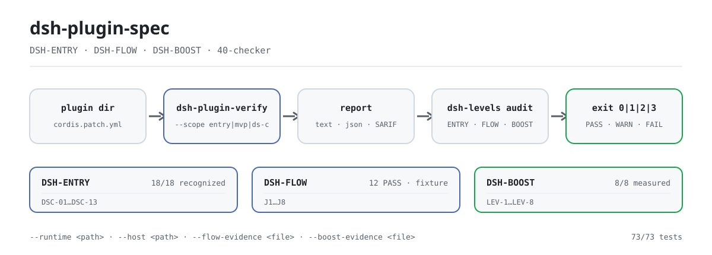

<div align="center">

<picture>
  <source media="(prefers-color-scheme: dark)" srcset="docs/assets/dsh-plugin-spec-flow-dark.svg">
  
</picture>

# dsh-plugin-spec

**把 DSH 插件规范变成可执行的检查——条款与检查器同仓，读完即可对插件目录出报告。**

DSH 插件三层规范（ENTRY / FLOW / BOOST）的规则源：条款文本、评分方案、证据链与治理记录都在这里，外加一个零依赖的只读检查器。

[安装](#三步上手) · [配置](#配置与参数) · [FAQ](#faq) · [简体中文](README.md) · [English](README.en.md) · [Español](README.es.md) · [Português](README.pt.md) · [हिन्दी](README.hi.md)

[](LICENSE)
[](https://www.npmjs.com/package/dsh-plugin-spec)
[](https://github.com/PerryLink/dsh-plugin-spec/actions/workflows/cross-platform.yml)
[](#开发)

[](https://github.com/PerryLink/dsh-plugin-spec/stargazers)
[](https://www.npmjs.com/package/dsh-plugin-spec)
[](https://gitee.com/perrylink/dsh-plugin-spec)

```sh
# 规范文本包（npm 已发布；无 bin，不提供 npx 命令）
npm i -g dsh-plugin-spec

# 检查器（未发布 npm；从源码运行）
git clone https://github.com/PerryLink/dsh-plugin-spec.git
node dsh-plugin-spec/40-checker/bin/dsh-plugin-verify.mjs --help
```

</div>

<sub>非官方、非认证、非安全审计；与 DeepSeek 无隶属关系。唯一仓库：<https://github.com/PerryLink/dsh-plugin-spec>（Gitee 为镜像）。复制或修改本仓文本必须附 Change Notice，见 [MODIFICATION-POLICY.md](MODIFICATION-POLICY.md)。</sub>

## 它是什么

本仓是 DSH 插件三层规范的规则源：**DSH-ENTRY 入门**（能不能装、能不能被识别）、**DSH-FLOW 顺畅**（J1–J8 旅程顺不顺）、**DSH-BOOST 加速**（LEV-1–8 实践有没有实测收益）。31/32/33 三份条款、评分方案、证据链与治理记录都在这里。

同仓还有 `40-checker`：零依赖、只读、Node ≥ 20 的检查器，把条款落成 `DSC-01`–`DSC-13` 的可执行判定，输出 `text` / `json` / `SARIF` 与 `PASS` / `WARN` / `FAIL` / `NA` / `ERROR` 五态结论；三层自检入口 `dsh-levels` 把 ENTRY、FLOW、BOOST 的结论合并到一份报告。

规范是草稿：ENTRY 已有 `recognized` 基线，FLOW / BOOST 明确标 `draft`；检查器是 MVP，只做它能证明的事——`static` 不写成 `runtime`，`not-run` 不写成 `PASS`。

| 层 | 规范/实践 | 当前状态 |
|---|---|---|
| 1 | **DSH-ENTRY 入门规范** | 18/18 `recognized`；base-only 10/18 已验证（8 clean + 2 gate-reject）；真实 web profile 18/18 已验证（16 clean + 2 gate-reject）；client 15/15 loaded；18/18 clean 未达成 |
| 2 | **DSH-FLOW 顺畅规范** | draft；fixture 上 J1/J2/J4/J6 **12 PASS**；J3/J7 fixture runtime；J5/J8 static preflight；10 个真实包 **78 PASS / 4 FAIL / 2 blocked / 66 not-run** |
| 3 | **DSH-BOOST 加速实践** | draft；LEV-1–8 **8/8 measured**（loader / context / provider-capture / synthetic timer；非生产基线） |

## 三步上手

1. **拿到文本与检查器**

   ```sh
   npm i -g dsh-plugin-spec        # 条款文本（无 bin）
   git clone https://github.com/PerryLink/dsh-plugin-spec.git
   cd dsh-plugin-spec/40-checker
   node --version                  # 需要 Node >= 20
   ```

   检查器未发布到 npm；npm 上的 `dsh-plugin-verify` / `dsh-levels` 是别的项目，**不要** `npx` 它们。

2. **对一个插件目录做静态识别**

   ```sh
   node bin/dsh-plugin-verify.mjs ./fixtures/good \
     --scope entry --entry-claim static
   ```

   输出包含 `scope=entry profile=package status=pass exit=0` 与 `level: DSH-ENTRY recognized`。`--entry-claim static` 明确只声明“结构可识别”；要声明 runtime，必须再加 `--runtime /path/to/cordis/lib/index.js`。

3. **确认三层结论**

   ```sh
   node bin/dsh-levels.mjs audit ./fixtures/good \
     --format json
   ```

   ENTRY 自动跑；FLOW / BOOST 只读 `--flow-evidence` / `--boost-evidence`，没有证据就写 `not-run` / `not-measured`——工具不会替作者升级。

第一次进仓先读 [START-HERE.md](START-HERE.md)；检查器细节见 [40-checker/README.md](40-checker/README.md)。

## 核心能力

- **三层条款一份规则源。** ENTRY / FLOW / BOOST 的条款、评分方案（A–D）、证据格式与治理记录同仓维护；执行层总入口是 `dsh-standards`，叙述性指南是 `dsh-plugin-guide`。
- **零依赖检查器。** `40-checker` 覆盖 `DSC-01`–`DSC-13`；`--scope` 三档（`ds-c` 默认 / `mvp` 8 项 / `entry` 兼容性门禁），`--profile` 三档（`package` 默认 / `listing` / `both`），输出 `text` / `json` / `SARIF 2.1.0`。
- **五态与 exit 码。** `PASS` 有证据满足；`WARN` 部分满足；`FAIL` 有反例；`NA` 不适用；`ERROR` 该跑没跑。exit `0` 完成且无 FAIL、`1` 有 FAIL、`2` incomplete、`3` 用法错误。
- **两层判定不混写。** `--static-only` 只判 `DSC-01/02/03/11/12/13`，结论是 `DS-C static`；只有 L1–L3 真跑才可能给 `DS-C verified`。
- **三层自检。** `dsh-levels audit` 合并 ENTRY 自动结论与 FLOW（J1–J8）/ BOOST（LEV-1–8）证据文件；没证据就写 `not-run` / `not-measured`。
- **证据链与治理。** `governance-check`、`attestation-check`、`claim-check`、`dco-check`、`evidence-chain verify` 把角色、贡献条款、公开声明与证据固定成可复跑的检查。
- **只读。** 不修改被检目录；检查器本体零第三方依赖。

配套工具链（脚手架 / 预检 / 宿主契约 / 安装冒烟 / 市场提交）的选型见 [docs/DEVELOPER-JOURNEY.md](docs/DEVELOPER-JOURNEY.md)。

### 当前硬数据

- 18 包 entry static：**18/18 recognized，0 clean**；
- 18 包 DS-C static：**0 PASS / 9 WARN / 9 FAIL**；
- 18 包 base-only runtime：**18/18 有原始 JSON；10/18 G3 verified，8 partial，0 error**；host gate 后 **8 clean + 2 reject + 8 partial**；
- client runtime：**15/15 `client-module-loaded`**（真实 Chromium）；web-app **4/4 loaded**；
- 不可用：**0 plugin code FAIL；2 host-gate reject（telemetry/verification）**；
- 检查器：**73/73 tests**（含治理 / DCO / 评价记录 / 声明 / 验真 / 链 / 漂移测试）；
- J1：**6 PASS + 1 WARN**；LEV-3：volatile **0/20** vs control **20/20** remount；LEV-6：稳定 prefix **100%** vs 易变 **0%**；LEV-7：**8.24×**（合成，非生产基线）。

## 配置与参数

检查器不读配置文件，全部由命令行参数控制；默认值来自 `40-checker/src/cli.mjs`。常用参数：

| 参数 | 默认值 | 作用 |
|---|---|---|
| `--format` | `text` | `text` / `json` / `sarif` |
| `--scope` | `ds-c` | `ds-c` 完整声明 / `mvp` 8 项 / `entry` 兼容性门禁 |
| `--profile` | `package` | `package` / `listing`；给了 `--market-index` 时默认 `listing` |
| `--runtime` | 无 | 已构建的 `@deepseek-ai/cordis` 入口；启用 L1–L3 |
| `--entry-claim` | `runtime` | `entry` scope 下声明 `runtime` 或 `static` |
| `--host` | 无 | `app-boot/lib/index.js`；bundle 的 G0–G3 |
| `--static-only` | 关 | M1 静态通道：只判 6 个 ID，结论 `DS-C static` |
| `--out` | stdout | 把报告写进文件 |

<details>
<summary>完整参数表（23 项）</summary>

| 参数 | 默认值 | 作用 |
|---|---|---|
| `--format` | `text` | `text` / `json` / `sarif` 输出格式 |
| `--scope` | `ds-c` | `mvp` = 8 个 MVP 检查项；`ds-c` = 完整声明；`entry` = DSH-ENTRY 兼容性门禁 |
| `--profile` | `package` | `package` / `listing` / `both`；给了 `--market-index` 时默认 `listing` |
| `--runtime` | 无 | 已构建的 `@deepseek-ai/cordis` `lib/index.js`；启用 L1–L3 |
| `--runtime-version` | `0.2.2-alpha.2` | C-2 使用的 DSH runtime 版本 |
| `--cordis-version` | `4.0.6-alpha.1` | 报告锚点记录的 Cordis 版本 |
| `--commit` | `ce7073d51254` | 报告锚点记录的 harness commit |
| `--install-spec` | 无 | C-3 推荐安装形态（listing / install 检查） |
| `--market-index` | 无 | format-1 市场索引 JSON；启用 C-3 listing 模式 |
| `--plugin-name` | 无 | 市场索引里的插件名 |
| `--timeout` | `10000` | L1–L3 超时（100–120000 毫秒） |
| `--no-exec` | 关 | 跳过 L1–L3，记为 `not-run` / `NA`，永不 `PASS` |
| `--static-only` | 关 | M1 模式：只判 `DSC-01/02/03/11/12/13`，C-4–C-9 记为 out-of-scope |
| `--treat-as-plugin` | 关 | 对 bundle 的 server entry 跑 L1–L3 |
| `--entry-runtime` | `require` | `entry` scope：`require` 要求完整 G0–G3，`server-entry` 只给代理结论 |
| `--entry-claim` | `runtime` | `entry` scope：`runtime` 需要 DSC-14，`static` 只声明结构可识别 |
| `--host` | 无 | `app-boot/lib/index.js`；启用 bundle G0–G3 冒烟 |
| `--base` | 无 | bundle 冒烟用的 base `cordis.patch.yml` |
| `--web` | 无 | bundle 冒烟用的 web-app `cordis.patch.yml` |
| `--bare` | 无 | bundle 冒烟用的裸模块 base（host farm） |
| `--out` | stdout | 把报告写进文件 |
| `--help` / `-h` | — | 打印用法 |
| `--version` / `-v` | — | 打印检查器版本 |

</details>

<details>
<summary><code>dsh-levels audit</code> 参数（10 项）</summary>

| 参数 | 默认值 | 作用 |
|---|---|---|
| `--host` | 无 | `app-boot/lib/index.js`；启用真实 ENTRY G0–G3 |
| `--base` | 无 | base `cordis.patch.yml` |
| `--bare` | 无 | bundle 冒烟用的裸模块 farm |
| `--no-runtime` | 关 | 即使给了 `--host` 也强制静态 ENTRY |
| `--flow-evidence` | 无 | FLOW 证据 JSON（J1–J8 的 `pass` / `fail` / `not-run`） |
| `--boost-evidence` | 无 | BOOST 证据 JSON（LEV-1–8 的证据卡） |
| `--timeout` | `150000` | 检查器超时（毫秒） |
| `--format` | `text` | `text` / `json` |
| `--out` | stdout | 把 JSON 结果写进文件 |
| `--help` | — | 打印用法 |

</details>

## FAQ

<details>
<summary>npm 上装了 <code>dsh-plugin-spec</code>，为什么没有命令？</summary>

这个 npm 包只发布条款文本（`files` 白名单是 README、LICENSE 与 31/32/33 三份规范），没有 `bin` 字段，因此 `npm i -g` 不会产生可执行命令，也没有 `npx` 入口。检查器在仓库的 `40-checker/` 里，未发布到 npm；请克隆后运行 `node 40-checker/bin/dsh-plugin-verify.mjs`。npm 上的同名 `dsh-plugin-verify` / `dsh-levels` 是别的项目，不要拿来跑本仓条款。

</details>

<details>
<summary>报告里的 <code>PASS</code> / <code>WARN</code> / <code>NA</code> / <code>ERROR</code> / <code>not-run</code> 怎么读？</summary>

`PASS` = 有证据满足；`WARN` = 部分满足或证据不足，不阻断但**不等于** PASS；`FAIL` = 有明确反例；`NA` = 形态或上下文不适用；`ERROR` / `not-run` = 该跑没跑或检查器失效。`NA` 与 `not-run` **都不是** PASS。`static` 结论也不能写成 `runtime`：要 `DS-C verified` 必须让 L1–L3 真跑。

</details>

<details>
<summary>会修改我的插件或上传代码吗？</summary>

不会。`40-checker` 是只读检查器：只读取目标目录并输出报告，不修改被检对象，本体零第三方依赖。L1–L3 需要你显式提供已构建的 `@deepseek-ai/cordis` 入口（`--runtime`）；bundle 的 G0–G3 需要显式提供 `--host`。没有给这些证据时，报告写 `not-run` / `incomplete`，不会替你补结论。

</details>

<details>
<summary>没有宿主（runtime / host）能跑吗？</summary>

能，但只能拿到静态结论。`--scope entry --entry-claim static` 做结构识别；`--static-only` 做 M1 静态通道。L1–L3 与 bundle G0–G3 需要真实宿主入口；缺宿主时检查器会明确写 `ERROR` / `not-run` 或 `incomplete`（exit `2`），而不是伪装通过。

</details>

<details>
<summary>这些结论能当认证、排名或安全审计吗？</summary>

不能。本仓是规范草稿与自检工具：不做认证 / 安全审计 / 排名，不收费、不卖等级。A–D 是质量等级，不是 ENTRY / FLOW / BOOST 的替代；`notClaimed` 字段也明确列出官方标准、认证、安全审计、排名与生产基线均未声明。

</details>

## 已知限制

**边界（原样保留）：**

- 不收费、不卖等级、不卖排名；
- 不做认证/安全审计；
- 不把 static 写成 runtime；
- 不把 10/18 base-only 写成 18/18 web/生产；不把 `client-module-loaded` 写成 UI/认证；
- 不声称官方推荐/采纳；
- 不声称认证/认可/安全审计；A–D 是质量等级，不是 ENTRY/FLOW/BOOST。

**检查器本身的限制（摘自 `40-checker/README.md`）：**

- `C-3` 只在 `listing` 模式可判；`package` 模式是 `NA`，仅附供应链 advisory 证据。
- L1–L3 已覆盖 13/14 个真实包；`dsh-vision-router` 构建后仍缺 `lib/session-affinity.js`，`FAIL`。
- `C-8.2` 的 revision/epoch 在 Cordis 4.0.5 构建里不可观测，good fixture 的 C-8 是 `WARN`。
- `C-13` 只判声明一致性；没有 `dsh.capabilities` 的插件无法被分类。
- `C-10` 是 advisory，不产生 `FAIL`。
- `dsh.commitments` / `dsh.disclosure` 缺失只记 `NA` / `WARN`。
- 目标只支持目录；tarball / npm 包解包未实现。
- 未实现 L4 冒烟、GitHub Action、M1/M2 双通道；M2 仍不是完整安全沙箱（读权限仍打开，无 seccomp/cgroup/只读 root）。

## 开发

```sh
cd 40-checker
node --test test/*.test.mjs
node bin/dsh-plugin-verify.mjs fixtures/good --format text
node bin/dsh-plugin-verify.mjs fixtures/bad --format text

# J1 安装/卸载旅程
node scripts/journey-runtime.mjs --package ./fixtures/good --json

# bundle 的 ENTRY G0–G3（需要 host）
node bin/dsh-plugin-verify.mjs ./my-bundle --scope entry \
  --host /path/to/app-boot/lib/index.js

# 治理 / 贡献 / 声明 / 证据链检查
node scripts/governance-check.mjs
node scripts/attestation-check.mjs
node scripts/claim-check.mjs
node scripts/dco-check.mjs --range HEAD~1..HEAD
node ../publish/verify.mjs --id DSH-ATT-2026-001

# LEV-7 有界并行基准
cd ../examples/boost
node lev7-bench.mjs 64 20
```

目录：

```text
00-99*.md         规范/研究/画像/沟通包
40-checker/       检查器、J1 旅程、bundle smoke、样本框、结果
governance/       角色/贡献条款/标志/申诉/COI/决策日志 + 机器检查
adoption/         official / market / developer 三套采用包
spec/             levels.json + clauses.json + schemas
examples/boost/   LEV-7 参考实现与基准
publish/          labels 示例 + 评价记录 JSON
scripts/          gen-readme-assets.py（配图复跑）
docs/assets/      README 配图（深浅双版 SVG）
```

配图由 `scripts/gen-readme-assets.py` 程序化生成（Python + Pillow），可重复执行：`python scripts/gen-readme-assets.py`。需要 Pillow 与一款 CJK 字体（脚本会探测，缺失即报错退出）。

### 治理与贡献

- 角色与权限：`governance/roles.json`；一页说明：[GOVERNANCE.md](GOVERNANCE.md)
- 贡献：DCO 1.1 + DCT v1（`dsh-ct/1`）；见 [CONTRIBUTING.md](CONTRIBUTING.md)
- 标志：`governance/mark-policy.md`（自动授予、可撤销、必须带免责声明）
- 申诉：`governance/appeals.md`；AI 只受理 / 计时 / 复核，人类终裁
- 三用途采用包：`adoption/{official,market,developer}/`

## 家族与致谢

本项目由 [PerryLink](https://github.com/PerryLink) 维护，是 DeepSeek Harness 插件家族的**规范规则源**：执行层面的总入口是 [dsh-standards](https://github.com/PerryLink/dsh-standards)，叙述性指南是 [dsh-plugin-guide](https://github.com/PerryLink/dsh-plugin-guide)，工具链见 [dsh-plugin-devtools](https://github.com/PerryLink/dsh-plugin-devtools)。

如果这套条款或检查器帮到了你，**给个 star**——它不解锁任何功能，但会让下一个人更容易找到它。

同生态的先行项目 `dsh-plugin-standard`（lanbaolu）与本项目无隶属关系；引用或对比时会标注来源。

- [@PerryLink](https://github.com/PerryLink) —— 创建者与维护者：三层条款、DSC 检查器、证据链与治理记录、五语文档。

## License

- 文本 / 规范 / 文档 / 翻译：**CC BY 4.0**（[LICENSE-CC-BY](LICENSE-CC-BY)）；复制或修改必须按 [MODIFICATION-POLICY.md](MODIFICATION-POLICY.md) 给出 Change Notice（来源 commit、改动章节、改了什么、为什么、日期）；
- 代码 / 脚本 / schema：**Apache-2.0**（[LICENSE-APACHE](LICENSE-APACHE)，含专利授权与防御终止）；
- 标志 / badge：单独规则，见 [governance/mark-policy.md](governance/mark-policy.md)，不随上述许可授权；
- 贡献：DCO 1.1 + DCT v1，不要求版权转让。

致谢与来源说明见 [NOTICE](NOTICE) 与 [CONTRIBUTING.md](CONTRIBUTING.md)。`DeepSeek Harness` 是 DeepSeek 的商标；本项目只使用 `DSH` 缩写。

<p align="center"><sub>CC BY 4.0（文本）/ Apache-2.0（代码）· 非官方规范草稿，与 DeepSeek 无隶属关系。</sub></p>
