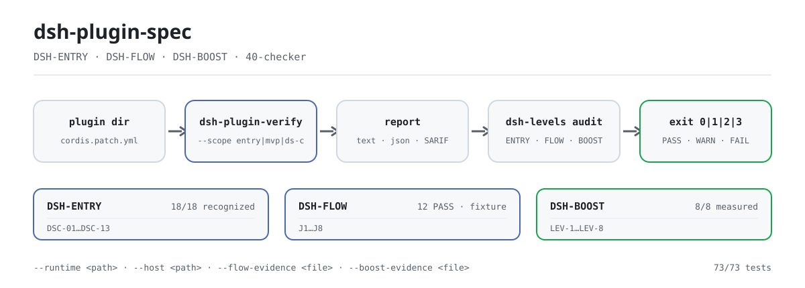

<div align="center">

<picture>
  <source media="(prefers-color-scheme: dark)" srcset="docs/assets/dsh-plugin-spec-flow-dark.svg">
  
</picture>

# dsh-plugin-spec

**Transforme os padrões de plugins do DSH em verificações executáveis: cláusulas e verificador no mesmo repositório, pronto para emitir um relatório sobre um diretório de plugin.**

A fonte de regras das três camadas de plugins do DSH (ENTRY / FLOW / BOOST): texto das cláusulas, esquema de pontuação, cadeia de evidências e registros de governança, além de um verificador somente leitura sem dependências.

[Instalar](#instalação-em-três-passos) · [Configuração](#configuração-e-parâmetros) · [FAQ](#faq) · [简体中文](README.md) · [English](README.en.md) · [Español](README.es.md) · [Português](README.pt.md) · [हिन्दी](README.hi.md)

[](LICENSE)
[](https://www.npmjs.com/package/dsh-plugin-spec)
[](https://github.com/PerryLink/dsh-plugin-spec/actions/workflows/cross-platform.yml)
[](#desenvolvimento)

[](https://github.com/PerryLink/dsh-plugin-spec/stargazers)
[](https://www.npmjs.com/package/dsh-plugin-spec)
[](https://gitee.com/perrylink/dsh-plugin-spec)

```sh
# pacote de texto dos padrões (publicado no npm; sem bin, sem comando npx)
npm i -g dsh-plugin-spec

# verificador (não publicado no npm; execute a partir do código-fonte)
git clone https://github.com/PerryLink/dsh-plugin-spec.git
node dsh-plugin-spec/40-checker/bin/dsh-plugin-verify.mjs --help
```

</div>

<sub>Não oficial, não é certificação nem auditoria de segurança; sem vínculo com a DeepSeek. Repositório canônico: <https://github.com/PerryLink/dsh-plugin-spec> (o Gitee é um espelho). Copiar ou modificar o texto deste repositório exige um Change Notice; consulte [MODIFICATION-POLICY.md](MODIFICATION-POLICY.md).</sub>

## O que é

Este repositório é a fonte de regras das três camadas de plugins do DSH: **DSH-ENTRY** (dá para instalar e reconhecer?), **DSH-FLOW** (as jornadas J1–J8 fluem sem atrito?) e **DSH-BOOST** (as práticas LEV-1–8 têm ganhos medidos?). Os três documentos de cláusulas (31/32/33), o esquema de pontuação, a cadeia de evidências e os registros de governança ficam aqui.

No mesmo repositório está o `40-checker`: um verificador somente leitura, sem dependências, para Node ≥ 20, que transforma as cláusulas em vereditos executáveis `DSC-01`–`DSC-13` e emite `text` / `json` / `SARIF` com cinco resultados: `PASS` / `WARN` / `FAIL` / `NA` / `ERROR`. Sua entrada de auditoria de três níveis, `dsh-levels`, funde ENTRY, FLOW e BOOST em um único relatório.

Os padrões são rascunhos: ENTRY já tem uma base `recognized`, enquanto FLOW / BOOST são explicitamente marcados como `draft`. O verificador é um MVP e só prova o que pode provar: `static` nunca é escrito como `runtime`, e `not-run` nunca é escrito como `PASS`.

| Camada | Padrão / prática | Estado atual |
|---|---|---|
| 1 | **Padrão de entrada DSH-ENTRY** | 18/18 `recognized`; base-only 10/18 verificados (8 clean + 2 gate-reject); perfil web real 18/18 verificados (16 clean + 2 gate-reject); client 15/15 carregados; 18/18 clean não alcançado |
| 2 | **Padrão de fluidez DSH-FLOW** | draft; J1/J2/J4/J6 **12 PASS** no fixture; J3/J7 runtime de fixture; J5/J8 preflight estático; 10 pacotes reais **78 PASS / 4 FAIL / 2 blocked / 66 not-run** |
| 3 | **Práticas de aceleração DSH-BOOST** | draft; LEV-1–8 **8/8 medidos** (loader / context / provider-capture / timer sintético; linha de base não produtiva) |

## Instalação em três passos

1. **Obter o texto e o verificador**

   ```sh
   npm i -g dsh-plugin-spec        # texto das cláusulas (sem bin)
   git clone https://github.com/PerryLink/dsh-plugin-spec.git
   cd dsh-plugin-spec/40-checker
   node --version                  # requer Node >= 20
   ```

   O verificador não está publicado no npm; os pacotes `dsh-plugin-verify` / `dsh-levels` do npm são outros projetos, então **não** os execute com `npx`.

2. **Executar o reconhecimento estático em um diretório de plugin**

   ```sh
   node bin/dsh-plugin-verify.mjs ./fixtures/good \
     --scope entry --entry-claim static
   ```

   A saída contém `scope=entry profile=package status=pass exit=0` e `level: DSH-ENTRY recognized`. `--entry-claim static` declara apenas reconhecimento estrutural; para declarar runtime, adicione `--runtime /path/to/cordis/lib/index.js`.

3. **Confirmar a conclusão de três níveis**

   ```sh
   node bin/dsh-levels.mjs audit ./fixtures/good \
     --format json
   ```

   ENTRY roda automaticamente; FLOW / BOOST leem apenas `--flow-evidence` / `--boost-evidence`. Sem evidência, são gravados `not-run` / `not-measured` — a ferramenta nunca eleva uma alegação por conta própria.

É a primeira vez neste repositório? Comece por [START-HERE.md](START-HERE.md); os detalhes do verificador estão em [40-checker/README.md](40-checker/README.md).

## Capacidades principais

- **Uma fonte de regras para três camadas.** As cláusulas ENTRY / FLOW / BOOST, o esquema de pontuação A–D, os formatos de evidência e os registros de governança ficam juntos. O projeto guarda-chuva de execução é `dsh-standards`; o guia em prosa é `dsh-plugin-guide`.
- **Verificador sem dependências.** O `40-checker` cobre `DSC-01`–`DSC-13`; `--scope` tem três modos (`ds-c` por padrão / `mvp` com 8 itens / `entry` para o portão de compatibilidade), `--profile` tem três (`package` por padrão / `listing` / `both`), e a saída é `text` / `json` / `SARIF 2.1.0`.
- **Cinco resultados e códigos de saída.** `PASS` tem evidência satisfatória; `WARN` é parcial; `FAIL` tem um contraexemplo; `NA` não se aplica; `ERROR` indica que a verificação não pôde rodar. Exit `0` = concluído sem FAIL, `1` = há FAIL, `2` = incompleto, `3` = erro de uso.
- **Sem misturar estático e runtime.** `--static-only` avalia apenas `DSC-01/02/03/11/12/13` e conclui `DS-C static`; somente uma execução real L1–L3 pode dar `DS-C verified`.
- **Auditoria de três níveis.** `dsh-levels audit` funde a conclusão automática de ENTRY com os arquivos de evidência de FLOW (J1–J8) / BOOST (LEV-1–8); sem evidência, grava `not-run` / `not-measured`.
- **Cadeia de evidências e governança.** `governance-check`, `attestation-check`, `claim-check`, `dco-check` e `evidence-chain verify` transformam papéis, termos de contribuição, alegações públicas e evidências em verificações repetíveis.
- **Somente leitura.** Nunca modifica o diretório alvo; o verificador não tem dependências de terceiros.

Para escolher a cadeia de ferramentas complementar (scaffold / preflight / contrato de host / smoke de instalação / envio ao mercado), consulte [docs/DEVELOPER-JOURNEY.md](docs/DEVELOPER-JOURNEY.md).

### Números atuais

- entry static de 18 pacotes: **18/18 recognized, 0 clean**;
- DS-C static de 18 pacotes: **0 PASS / 9 WARN / 9 FAIL**;
- runtime base-only de 18 pacotes: **18/18 com JSON bruto; 10/18 G3 verificados, 8 parciais, 0 erros**; após o portão de host, **8 clean + 2 reject + 8 parciais**;
- runtime de client: **15/15 `client-module-loaded`** (Chromium real); web-app **4/4 carregados**;
- inutilizáveis: **0 FAIL de código de plugin; 2 rejeições do portão de host (telemetry/verification)**;
- verificador: **73/73 testes** (governança / DCO / atestação / alegações / verificação / cadeia / deriva);
- J1: **6 PASS + 1 WARN**; LEV-3: volatile **0/20** contra control **20/20** remount; LEV-6: prefixo estável **100%** contra volátil **0%**; LEV-7: **8.24×** (sintético, não uma linha de base de produção).

## Configuração e parâmetros

O verificador não lê arquivo de configuração; tudo é controlado por parâmetros de linha de comando, com padrões em `40-checker/src/cli.mjs`. Parâmetros comuns:

| Parâmetro | Padrão | Função |
|---|---|---|
| `--format` | `text` | `text` / `json` / `sarif` |
| `--scope` | `ds-c` | `ds-c` declaração completa / `mvp` 8 itens / `entry` portão de compatibilidade |
| `--profile` | `package` | `package` / `listing`; vira `listing` quando `--market-index` é informado |
| `--runtime` | nenhum | Entrada compilada do `@deepseek-ai/cordis`; habilita L1–L3 |
| `--entry-claim` | `runtime` | Em `entry`, declara `runtime` ou `static` |
| `--host` | nenhum | `app-boot/lib/index.js`; G0–G3 de bundle |
| `--static-only` | não | Canal estático M1: apenas 6 IDs, conclusão `DS-C static` |
| `--out` | stdout | Grava o relatório em um arquivo |

<details>
<summary>Tabela completa de parâmetros (23 itens)</summary>

| Parâmetro | Padrão | Função |
|---|---|---|
| `--format` | `text` | Formato de saída: `text` / `json` / `sarif` |
| `--scope` | `ds-c` | `mvp` = 8 verificações MVP; `ds-c` = declaração completa; `entry` = portão de compatibilidade DSH-ENTRY |
| `--profile` | `package` | `package` / `listing` / `both`; vira `listing` quando `--market-index` é informado |
| `--runtime` | nenhum | `lib/index.js` compilado do `@deepseek-ai/cordis`; habilita L1–L3 |
| `--runtime-version` | `0.2.2-alpha.2` | Versão de runtime DSH usada por C-2 |
| `--cordis-version` | `4.0.6-alpha.1` | Versão do Cordis registrada na âncora do relatório |
| `--commit` | `ce7073d51254` | Commit do harness registrado na âncora do relatório |
| `--install-spec` | nenhum | Especificação de instalação recomendada para C-3 (listing / install) |
| `--market-index` | nenhum | JSON de índice de mercado format-1; habilita o modo C-3 listing |
| `--plugin-name` | nenhum | Nome do plugin dentro do índice de mercado |
| `--timeout` | `10000` | Tempo limite de L1–L3 (100–120000 ms) |
| `--no-exec` | não | Pula L1–L3 como `not-run` / `NA`, nunca `PASS` |
| `--static-only` | não | Modo M1: apenas `DSC-01/02/03/11/12/13`; C-4–C-9 ficam fora de escopo |
| `--treat-as-plugin` | não | Roda L1–L3 no server entry de um bundle |
| `--entry-runtime` | `require` | Em `entry`: `require` exige G0–G3 completos; `server-entry` dá uma conclusão proxy |
| `--entry-claim` | `runtime` | Em `entry`: `runtime` exige DSC-14; `static` declara apenas reconhecimento estrutural |
| `--host` | nenhum | `app-boot/lib/index.js`; habilita o smoke G0–G3 de bundle |
| `--base` | nenhum | `cordis.patch.yml` base para o smoke de bundle |
| `--web` | nenhum | `cordis.patch.yml` de web-app para o smoke de bundle |
| `--bare` | nenhum | Base de módulos nus (host farm) para o smoke de bundle |
| `--out` | stdout | Grava o relatório em um arquivo |
| `--help` / `-h` | — | Mostra o uso |
| `--version` / `-v` | — | Mostra a versão do verificador |

</details>

<details>
<summary>Parâmetros do <code>dsh-levels audit</code> (10 itens)</summary>

| Parâmetro | Padrão | Função |
|---|---|---|
| `--host` | nenhum | `app-boot/lib/index.js`; habilita ENTRY G0–G3 real |
| `--base` | nenhum | `cordis.patch.yml` base |
| `--bare` | nenhum | Host farm de módulos nus para o smoke de bundle |
| `--no-runtime` | não | Força ENTRY estático mesmo com `--host` |
| `--flow-evidence` | nenhum | JSON de evidência FLOW (J1–J8 `pass` / `fail` / `not-run`) |
| `--boost-evidence` | nenhum | JSON de evidência BOOST (cartões LEV-1–8) |
| `--timeout` | `150000` | Tempo limite do verificador (ms) |
| `--format` | `text` | `text` / `json` |
| `--out` | stdout | Grava o resultado JSON em um arquivo |
| `--help` | — | Mostra o uso |

</details>

## FAQ

<details>
<summary>Instalei o <code>dsh-plugin-spec</code> pelo npm — por que não há comando?</summary>

O pacote npm publica apenas o texto das cláusulas (sua lista `files` é README, LICENSE e os padrões 31/32/33); não tem campo `bin`, então `npm i -g` não produz executável e também não há entrada `npx`. O verificador fica em `40-checker/` e não está publicado no npm; clone o repositório e execute `node 40-checker/bin/dsh-plugin-verify.mjs`. Os pacotes `dsh-plugin-verify` / `dsh-levels` do npm são outros projetos: não os use para rodar estas cláusulas.

</details>

<details>
<summary>Como ler <code>PASS</code> / <code>WARN</code> / <code>NA</code> / <code>ERROR</code> / <code>not-run</code>?</summary>

`PASS` = há evidência satisfatória; `WARN` = parcial ou evidência insuficiente, não bloqueia mas **não** é PASS; `FAIL` = contraexemplo concreto; `NA` = não se aplica nesta forma ou contexto; `ERROR` / `not-run` = deveria ter rodado e não rodou, ou o verificador falhou. Nem `NA` nem `not-run` são PASS. Uma conclusão `static` não deve ser escrita como `runtime`: `DS-C verified` exige uma execução real L1–L3.

</details>

<details>
<summary>Ele modifica meu plugin ou envia meu código?</summary>

Não. O `40-checker` é um verificador somente leitura: lê o diretório alvo e grava um relatório, sem modificar o alvo, e não tem dependências de terceiros. L1–L3 precisa de uma entrada compilada do `@deepseek-ai/cordis` fornecida explicitamente (`--runtime`); o G0–G3 de bundle precisa de um `--host` explícito. Sem essa evidência, o relatório diz `not-run` / `incomplete` em vez de inventar uma conclusão.

</details>

<details>
<summary>Dá para rodar sem host (runtime / host)?</summary>

Sim, mas apenas até uma conclusão estática. `--scope entry --entry-claim static` faz reconhecimento estrutural; `--static-only` é o canal estático M1. L1–L3 e o G0–G3 de bundle exigem uma entrada de host real; quando ela falta, o verificador informa explicitamente `ERROR` / `not-run` ou `incomplete` (exit `2`) em vez de fingir que passou.

</details>

<details>
<summary>Essas conclusões servem como certificação, ranking ou auditoria de segurança?</summary>

Não. Este repositório é um rascunho de padrões e uma ferramenta de autoverificação: não certifica, não audita e não classifica; não cobra nem vende níveis. A–D é uma nota de qualidade, não um substituto de ENTRY / FLOW / BOOST. O campo `notClaimed` também lista como não declarados padrão oficial, certificação, auditoria de segurança, ranking e linha de base de produção.

</details>

## Limitações conhecidas

**Limites (preservados literalmente):**

- Sem cobrança, sem venda de níveis, sem venda de rankings;
- Sem certificação / auditoria de segurança;
- Nunca escrever static como runtime;
- Nunca escrever 10/18 base-only como 18/18 web/produção; nunca escrever `client-module-loaded` como UI/certificação;
- Sem alegação de recomendação / adoção oficial;
- Sem alegação de certificação / acreditação / auditoria de segurança; A–D são notas de qualidade, não ENTRY/FLOW/BOOST.

**Limitações do verificador (citadas de `40-checker/README.md`):**

- `C-3` só pode ser julgado no modo `listing`; o modo `package` informa `NA` apenas com evidência advisory de cadeia de suprimentos.
- L1–L3 cobre 13/14 pacotes reais; o `dsh-vision-router` continua sem `lib/session-affinity.js` após a compilação, então é `FAIL`.
- A revisão/epoch de `C-8.2` não é observável em builds do Cordis 4.0.5, então o C-8 do fixture good é `WARN`.
- `C-13` julga apenas a consistência da declaração; plugins sem `dsh.capabilities` não podem ser classificados.
- `C-10` é advisory e nunca produz `FAIL`.
- A ausência de `dsh.commitments` / `dsh.disclosure` é registrada apenas como `NA` / `WARN`.
- O alvo deve ser um diretório; o desempacotamento de tarball / pacote npm não está implementado.
- O smoke L4, a GitHub Action e o canal duplo M1/M2 não estão implementados; o M2 ainda não é uma sandbox de segurança completa (as leituras continuam abertas; sem seccomp/cgroup/root somente leitura).

## Desenvolvimento

```sh
cd 40-checker
node --test test/*.test.mjs
node bin/dsh-plugin-verify.mjs fixtures/good --format text
node bin/dsh-plugin-verify.mjs fixtures/bad --format text

# jornada J1 de instalação/desinstalação
node scripts/journey-runtime.mjs --package ./fixtures/good --json

# ENTRY G0–G3 de bundle (precisa de um host)
node bin/dsh-plugin-verify.mjs ./my-bundle --scope entry \
  --host /path/to/app-boot/lib/index.js

# verificações de governança / contribuição / alegações / cadeia de evidências
node scripts/governance-check.mjs
node scripts/attestation-check.mjs
node scripts/claim-check.mjs
node scripts/dco-check.mjs --range HEAD~1..HEAD
node ../publish/verify.mjs --id DSH-ATT-2026-001

# benchmark de paralelismo limitado LEV-7
cd ../examples/boost
node lev7-bench.mjs 64 20
```

Estrutura:

```text
00-99*.md         padrões / pesquisa / perfis / pacotes de comunicação
40-checker/       verificador, jornadas J1, smoke de bundle, quadro de amostras, resultados
governance/       papéis / termos de contribuição / marcas / apelações / COI / registro + verificações
adoption/         pacotes de adoção official / market / developer
spec/             levels.json + clauses.json + schemas
examples/boost/   implementação de referência e benchmark LEV-7
publish/          exemplos de labels + JSON de atestação
scripts/          gen-readme-assets.py (regeneração de recursos)
docs/assets/      recursos do README (par SVG claro/escuro)
```

Os recursos são gerados programaticamente por `scripts/gen-readme-assets.py` (Python + Pillow) e podem ser regenerados com `python scripts/gen-readme-assets.py`. Requer Pillow e uma fonte CJK (o script a procura e aborta se não encontrar nenhuma).

### Governança e contribuição

- Papéis e permissões: `governance/roles.json`; guia de uma página: [GOVERNANCE.md](GOVERNANCE.md)
- Contribuição: DCO 1.1 + DCT v1 (`dsh-ct/1`); consulte [CONTRIBUTING.md](CONTRIBUTING.md)
- Marcas: `governance/mark-policy.md` (concessão automática, revogável, isenção de responsabilidade obrigatória)
- Apelações: `governance/appeals.md`; a IA apenas recebe / cronometra / revisa, a decisão final é humana
- Pacotes de adoção de três finalidades: `adoption/{official,market,developer}/`

## Família e agradecimentos

Este projeto é mantido por [PerryLink](https://github.com/PerryLink) e é a **fonte de regras** da família de plugins do DeepSeek Harness: o projeto guarda-chuva de execução é o [dsh-standards](https://github.com/PerryLink/dsh-standards), o guia em prosa é o [dsh-plugin-guide](https://github.com/PerryLink/dsh-plugin-guide) e a cadeia de ferramentas é o [dsh-plugin-devtools](https://github.com/PerryLink/dsh-plugin-devtools).

Se estas cláusulas ou o verificador ajudaram você, **deixe uma estrela** — não desbloqueia nada, mas ajuda a próxima pessoa a encontrá-lo.

O projeto anterior `dsh-plugin-standard` (lanbaolu) é um esforço independente, sem afiliação; citações ou comparações indicarão a origem.

- [@PerryLink](https://github.com/PerryLink) — criador e mantenedor: cláusulas de três camadas, verificador DSC, cadeia de evidências e registros de governança, e documentação em cinco idiomas.

## Licença

- Texto / padrões / documentação / traduções: **CC BY 4.0** ([LICENSE-CC-BY](LICENSE-CC-BY)); copiar ou modificar exige um Change Notice conforme [MODIFICATION-POLICY.md](MODIFICATION-POLICY.md) (commit de origem, seção alterada, o que mudou, por que, data);
- Código / scripts / schemas: **Apache-2.0** ([LICENSE-APACHE](LICENSE-APACHE), com concessão de patentes e terminação defensiva);
- Marcas / badges: regras separadas em [governance/mark-policy.md](governance/mark-policy.md), não concedidas pelas licenças acima;
- Contribuições: DCO 1.1 + DCT v1, sem cessão de direitos autorais.

As notas de atribuição e procedência estão em [NOTICE](NOTICE) e [CONTRIBUTING.md](CONTRIBUTING.md). `DeepSeek Harness` é uma marca da DeepSeek; este projeto usa apenas a abreviação `DSH`.

<p align="center"><sub>CC BY 4.0 (texto) / Apache-2.0 (código) · rascunho de padrões não oficial, sem vínculo com a DeepSeek.</sub></p>
